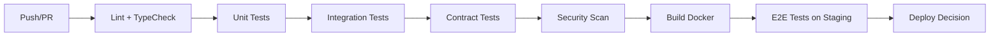

# 测试策略文档 (Test Strategy)

## 1. 概述

本文档定义了 Douyin Monitor 项目的测试策略，涵盖单元测试、集成测试、契约测试、端到端测试等多层级测试体系，确保代码质量与系统可靠性。

### 1.1 测试目标
- **功能正确性**：验证业务逻辑符合需求规格
- **回归防护**：确保重构/新增功能不破坏现有行为
- **性能基线**：关键路径响应时间 ≤ 200ms（API），页面加载 ≤ 3s
- **安全合规**：依赖漏洞扫描、敏感信息泄露检测
- **可维护性**：测试代码作为活文档，便于新成员理解业务

### 1.2 测试金字塔
```
                    ┌─────────────┐
                    │  E2E Tests  │  ← 少量，核心用户旅程
                    │  (Playwright)│
                ┌─────────────────┐
                │ Contract Tests  │  ← API 契约验证
                │   (Pact/Swagger) │
            ┌───────────────────────┐
            │  Integration Tests    │  ← 服务间交互、DB、外部 API
            │   (Testcontainers)    │
        ┌─────────────────────────────┐
        │      Unit Tests             │  ← 大量，快速，隔离
        │   (pytest / Vitest)         │
        └─────────────────────────────┘
```

---

## 2. 单元测试

### 2.1 后端
| 维度 | 标准 |
|------|------|
| **框架** | `pytest` + `pytest-mock` + `pytest-cov` |
| **覆盖率目标** | ≥ 85%（核心业务逻辑 ≥ 95%） |
| **命名规范** | `test_<module>_<function>_<scenario>` |
| **执行速度** | 单测总耗时 < 30s |

### 2.2 关键模块测试重点
| 模块 | 测试场景 |
|------|----------|
| `config.py` | 环境变量解析、默认值、类型转换、缺失必填项报错 |
| `douyin_sign.py` | 签名算法正确性、边界参数、异常输入 |
| `app.py` - `_request` | 重试策略、超时、错误码映射、Header 注入 |
| `app.py` - `fetch_and_store_*` | 字段标准化、默认值填充、持久化调用 |
| `tasks.py` - Celery 任务 | 任务幂等性、重试、失败告警 |
| `utils/formatters.ts` | 格式化函数边界值、空值、负数、大数 |

### 2.3 Mock 策略
```python
# 示例：外部 API 调用统一使用 Mock
@pytest.fixture
def mock_external_api(monkeypatch):
    async def mock_get(*args, **kwargs):
        return {"data": {"products": [{"product_id": "p1", "sales_today": 100}]}}
    monkeypatch.setattr("app._request", mock_get)

# 数据库/Redis 使用 fakeredis / sqlite 内存模式
@pytest.fixture
def fake_redis():
    import fakeredis
    return fakeredis.FakeRedis()
```

### 2.4 测试数据管理
- **Fixtures**：`tests/fixtures/` 存放 JSON 样本数据（products.json, orders.json 等）
- **Factory**：使用 `factory_boy` 生成动态测试数据
- **参数化**：`@pytest.mark.parametrize` 覆盖多场景

---

## 3. 集成测试

### 3.1 范围
- Flask 应用完整启动（TestClient）
- Redis / Celery 真实交互（Testcontainers）
- 外部 API 契约验证（录制/回放模式）

### 3.2 关键测试场景
| 场景 | 验证点 |
|------|--------|
| 完整同步流程 | `POST /api/sync` → 触发 Celery → 数据落盘 → 缓存更新 → 告警检查 |
| 分页查询 | `/api/products?page=2&size=10` 正确返回分页元数据 |
| 签名参数注入 | 请求 Header 包含 `a_bogus`、`msToken` 等动态参数 |
| 告警触发 | 模拟销量下跌 40% → 生成告警记录 → 发送邮件（Mock SMTP） |
| 健康检查 | `/api/health` 返回 `status: healthy` + 最近同步时间 |

### 3.3 环境隔离
```yaml
# tests/integration/conftest.py
@pytest.fixture(scope="session")
def docker_services():
    import testcontainers.redis
    redis = testcontainers.redis.RedisContainer("redis:7-alpine")
    redis.start()
    yield {"redis": redis.get_container_host_ip(), "port": redis.get_exposed_port(6379)}
    redis.stop()
```

---

## 4. 契约测试

### 4.1 目的
确保前后端 API 接口兼容，防止破坏性变更。

### 4.2 实现方案
| 方案 | 适用场景 |
|------|----------|
| **OpenAPI 规范验证** | CI 中用 `swagger-codegen` 或 `openapi-validator` 验证 `app.py` 生成的 `openapi.json` |
| **Pact 消费者驱动契约** | 前端作为 Consumer，后端作为 Provider，验证请求/响应结构 |
| **TypeScript 类型同步** | `openapi-typescript` 从 OpenAPI 生成前端类型，编译时即报错 |

### 4.3 CI 集成
```yaml
# .github/workflows/ci.yml
- name: Validate OpenAPI spec
  run: |
    python -c "import json; json.load(open('openapi.json'))"  # 语法检查
    npx @redocly/openapi-cli lint openapi.json  # 规范检查
- name: Generate frontend types
  run: |
    npx openapi-typescript openapi.json -o frontend/src/types/api.d.ts
    npx tsc --noEmit  # 类型检查
```

---

## 5. 端到端测试

### 5.1 工具
- **Playwright** (TypeScript)：跨浏览器、自动等待、截图/视频录制

### 5.2 核心用户旅程
| 旅程 | 步骤 | 验证点 |
|------|------|--------|
| 仪表盘查看 | 登录 → 访问 `/` → 等待数据加载 | 4 个指标卡片显示、4 个图表渲染、表格数据非空 |
| 手动同步 | 点击“立即同步” → 等待完成 → 刷新页面 | 数据更新时间刷新、最新数据展示 |
| 告警配置 | 进入 `/alerts/douyin` → 修改阈值 → 保存 | 保存成功提示、配置持久化、下次检查生效 |
| 商品搜索 | 访问 `/dian/products` → 输入关键词 → 筛选状态 | 列表实时过滤、分页正常、导出 CSV 含筛选数据 |

### 5.3 执行策略
- **CI**：每日定时运行 + PR 合并前运行
- **本地**：`npx playwright test --headed` 调试
- **报告**：HTML 报告 + 失败截图/视频上传到 Artifacts

---

## 6. 性能测试

### 6.1 目标
| 指标 | 目标 |
|------|------|
| API P95 响应时间 | ≤ 200ms |
| API P99 响应时间 | ≤ 500ms |
| 并发吞吐 | ≥ 100 RPS (单实例) |
| 页面首屏加载 (LCP) | ≤ 2.5s |

### 6.2 工具与脚本
```bash
# 使用 k6 进行负载测试
# tests/performance/api_load.js
export const options = {
  stages: [
    { duration: '30s', target: 50 },   // 预热
    { duration: '1m', target: 100 },   // 压测
    { duration: '30s', target: 0 },    // 冷却
  ],
  thresholds: {
    http_req_duration: ['p(95)<200', 'p(99)<500'],
    http_req_failed: ['rate<0.01'],
  },
}
```

---

## 7. 安全测试

### 7.1 依赖漏洞扫描
| 工具 | 频率 | 阈值 |
|------|------|------|
| `pip-audit` / `safety` | 每次 CI | 0 High/Critical |
| `npm audit` | 每次 CI | 0 High/Critical |
| `trivy` (Docker 镜像) | Release 前 | 0 Critical |

### 7.2 静态分析 (SAST)
- **Bandit** (Python)：硬编码密钥、SQL 注入、不安全反序列化
- **ESLint Security Plugin** (TS)：XSS、原型污染、eval 使用

### 7.3 密钥泄露检测
- **GitLeaks** / **TruffleHog** 预提交钩子 + CI 扫描历史提交

---

## 8. 测试环境与数据

### 8.1 环境矩阵
| 环境 | 用途 | 数据来源 |
|------|------|----------|
| **Local** | 开发调试 | Mock / 本地 JSON |
| **CI** | 自动化验证 | Fixtures + Testcontainers |
| **Staging** | 预发布验证 | 生产数据脱敏子集 |
| **Production** | 监控告警 | 真实数据 |

### 8.2 测试数据规范
- **不使用生产真实数据** 进行自动化测试
- 脱敏规则：ID 哈希、姓名/手机/邮箱掩码、金额随机偏移 ±10%
- 数据版本控制：`tests/fixtures/v1/` 目录管理，Schema 变更同步更新

---

## 9. CI/CD 集成流程



### 9.1 门禁规则
| 阶段 | 必须通过 | 可选 |
|------|----------|------|
| Lint/TypeCheck | ✅ | - |
| Unit Tests | ✅ (覆盖率 ≥ 85%) | - |
| Integration Tests | ✅ | - |
| Contract Tests | ✅ | - |
| Security Scan | ✅ (0 Critical/High) | - |
| E2E Tests | - | ✅ (Staging) |

---

## 10. 测试报告与度量

### 10.1 关键指标仪表盘
| 指标 | 来源 | 告警阈值 |
|------|------|----------|
| 单测覆盖率 | `pytest-cov` / Codecov | < 80% 报警 |
| 集成测试通过率 | CI Artifacts | < 100% 阻断合并 |
| 契约测试通过率 | Pact Broker / CI | < 100% 报警 |
| 严重漏洞数 | Trivy / pip-audit | > 0 阻断发布 |
| E2E 通过率 | Playwright Report | < 95% 报警 |

### 10.2 趋势分析
- 覆盖率趋势图（周/月）
- 失败测试分类统计（环境/代码/数据）
- 平均修复时间 (MTTR)

---

## 11. 角色与职责

| 角色 | 职责 |
|------|------|
| **开发人员** | 编写单测、集成测、契约测；PR 自测通过后提交 |
| **QA** | 维护 E2E 测试套件、性能基线、测试数据管理 |
| **Tech Lead** | 评审测试策略、把控覆盖率门禁、定期复盘质量指标 |
| **DevOps** | 维护 CI 流水线、测试环境、报告仪表盘 |

---

## 12. 版本历史

| 版本 | 日期 | 变更说明 | 作者 |
|------|------|----------|------|
| 1.0.0 | 2026-08-18 | 初始版本：定义测试金字塔、各层级标准、CI 集成流程 | Auto |

---

> **执行建议**：
> 1. 优先补齐核心模块单测（`config.py`、`douyin_sign.py`、`_request`、`fetch_and_store_*`）
> 2. 引入 Testcontainers 实现集成测试真实 Redis/Celery
> 3. 配置 Playwright E2E 核心 4 条用户旅程
> 4. 接入 Codecov + Pact Broker 可视化质量看板