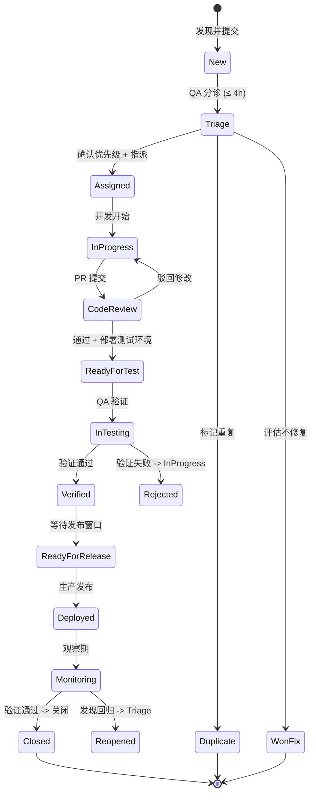

# 测试计划 (Test Plan)

> **文档版本**: 2.0  
> **文档状态**: 生效中  
> **最后更新**: 2026-08-25  
> **文档责任人**: QA 负责人  
> **适用范围**: Phase 1 验收 (M8 里程碑) 及后续迭代  
> **关联文档**: [TEST_STRATEGY.md](TEST_STRATEGY.md)、[QUALITY_PLAN.md](QUALITY_PLAN.md)、[ISSUE_TRACKER_TEMPLATE.md](ISSUE_TRACKER_TEMPLATE.md)、[PROJECT_CHARTER.md](PROJECT_CHARTER.md)

---

## 1. 测试计划概述

### 1.1 测试目标
本测试计划旨在验证 Douyin Monitor 项目 Phase 1 是否满足 [PROJECT_CHARTER.md](PROJECT_CHARTER.md) 中定义的成功准入标准 (Definition of Done):
- 所有 OBJ-01 到 OBJ-05 指标达标
- 代码覆盖率 ≥ 80%（核心模块 100%）
- 无 P1/P2 安全漏洞 (Trivy/Snyk 扫描)
- 性能测试：API P99 < 500ms，并发支持 100 QPS
- 文档完整：架构、设计、API、运维手册、风险登记
- 完成生产环境灰度发布 1 周无严重事故
- 执行发起人签字确认

### 1.2 测试范围

| 范围 | 包含 | 不包含 |
|------|------|--------|
| **功能测试** | 后端 API、同步引擎、规则引擎、前端 Dashboard、告警系统 | 跨平台数据 (Phase 2) |
| **非功能测试** | 性能、安全、兼容性、可访问性、可观测性 | 灾备演练 (Phase 2) |
| **集成测试** | 内部服务间、外部 API 契约、Redis/Celery | 第三方 OA 集成 |
| **端到端测试** | 核心用户旅程 (4 条)、关键运营场景 | 全量用户路径 |
| **验收测试** | 干系人验收、Sponsor 签字、生产灰度 | UAT 业务场景全量 |

### 1.3 测试依据
- [REQUIREMENTS.md](REQUIREMENTS.md)
- [DESIGN.md](DESIGN.md)
- [ARCHITECTURE.md](ARCHITECTURE.md)
- [INTERNAL-API-SPEC.md](INTERNAL-API-SPEC.md) / [openapi.yaml](../api/openapi.yaml)
- [FRONTEND_DESIGN.md](FRONTEND_DESIGN.md)

---

## 2. 测试阶段与时间表

| 阶段 | 起始日期 | 结束日期 | 责任人 | 交付物 | 状态 |
|------|----------|----------|--------|--------|------|
| **测试准备** | 2026-08-25 | 2026-08-28 | QA Lead | 测试环境、数据、用例评审 | 🔄 进行中 |
| **单元测试补全** | 2026-08-25 | 2026-08-30 | Dev Team | 覆盖率 ≥ 85% 报告 | 🔄 进行中 |
| **集成测试执行** | 2026-08-28 | 2026-09-02 | QA + Dev | 集成测试报告 | ⏳ 计划中 |
| **端到端测试** | 2026-09-01 | 2026-09-05 | QA | E2E 测试报告 + 缺陷清单 | ⏳ 计划中 |
| **性能基线测试** | 2026-09-05 | 2026-09-07 | DevOps + QA | 性能基线报告 | ⏳ 计划中 |
| **安全测试与审计** | 2026-09-08 | 2026-09-10 | DevOps + Security | 渗透测试报告、漏洞清单 | ⏳ 计划中 |
| **UAT 用户验收** | 2026-09-10 | 2026-09-12 | PM + 业务方 | UAT 验收报告 | ⏳ 计划中 |
| **生产灰度发布** | 2026-09-12 | 2026-09-19 | DevOps | 灰度观察报告 (1 周) | ⏳ 计划中 |
| **正式验收** | 2026-09-15 | 2026-09-15 | PM + Sponsor | 验收报告 + 签字 | ⏳ 计划中 |

---

## 3. 测试用例矩阵

### 3.1 后端 API 测试用例 (TC-API-*)

| 用例 ID | 模块 | 用例标题 | 优先级 | 前置条件 | 测试步骤 | 预期结果 | 关联需求 |
|---------|------|----------|--------|----------|----------|----------|----------|
| TC-API-001 | 鉴权 | 有效 Token 访问受保护接口 | P0 | 用户已登录获取 Token | 1. 携带 Token 调用 `/api/v1/products` | 200 OK + 数据返回 | REQ-001 |
| TC-API-002 | 鉴权 | 无 Token 访问受保护接口 | P0 | 无 | 1. 不带 Token 调用 `/api/v1/products` | 401 Unauthorized | REQ-001 |
| TC-API-003 | 鉴权 | 过期 Token 访问 | P0 | Token 已过期 | 1. 携带过期 Token 调用 | 401 + 错误码 TOKEN_EXPIRED | REQ-001 |
| TC-API-004 | 鉴权 | 无效 Token 格式 | P1 | Token 格式错误 | 1. 携带 `Bearer xxx` 调用 | 401 + 错误码 TOKEN_INVALID | REQ-001 |
| TC-API-005 | 限流 | 超出 QPS 阈值 (100 QPS) | P1 | 用户已认证 | 1. 101 并发请求 | 部分返回 429 Too Many Requests | REQ-002 |
| TC-API-006 | 商品查询 | 分页查询商品列表 | P0 | 数据库有数据 | 1. `GET /api/v1/products?page=1&size=20` | 200 + 分页元数据正确 | REQ-010 |
| TC-API-007 | 商品查询 | 按关键词搜索 | P0 | 数据库有匹配数据 | 1. `GET /api/v1/products?keyword=手机` | 200 + 仅返回匹配项 | REQ-010 |
| TC-API-008 | 商品查询 | 按状态筛选 | P1 | 数据库有多状态数据 | 1. `GET /api/v1/products?status=在售` | 200 + 仅返回在售商品 | REQ-010 |
| TC-API-009 | 商品查询 | 无匹配结果 | P2 | 查询条件不匹配 | 1. `GET /api/v1/products?keyword=不存在` | 200 + 空列表 | REQ-010 |
| TC-API-010 | 商品查询 | 非法分页参数 | P1 | - | 1. `GET /api/v1/products?page=-1` | 400 Bad Request | REQ-010 |
| TC-API-011 | 订单查询 | 按日期范围查询 | P0 | 数据库有时间范围数据 | 1. `GET /api/v1/orders?start_date=2026-08-01&end_date=2026-08-31` | 200 + 仅返回范围内订单 | REQ-011 |
| TC-API-012 | 订单查询 | 跨日期范围限制 | P1 | - | 1. 查询超过 90 天范围 | 400 + 错误提示 | REQ-011 |
| TC-API-013 | 同步任务 | 手动触发同步 | P0 | 服务正常 | 1. `POST /api/v1/sync` | 202 Accepted + 任务 ID | REQ-020 |
| TC-API-014 | 同步任务 | 查询同步状态 | P0 | 有进行中任务 | 1. `GET /api/v1/sync/status/{task_id}` | 200 + 状态 (pending/running/success/failed) | REQ-020 |
| TC-API-015 | 同步任务 | 重复触发同步 (锁机制) | P1 | 同步进行中 | 1. 再次 `POST /api/v1/sync` | 409 Conflict + 已有任务提示 | REQ-020 |
| TC-API-016 | 同步任务 | 同步失败重试 | P1 | 外部 API 故障 | 1. 模拟 API 失败 → 触发重试 | 重试 3 次后标记 failed + 告警 | REQ-020 |
| TC-API-017 | 告警配置 | 创建告警规则 | P0 | 用户已认证 | 1. `POST /api/v1/alerts` 含完整配置 | 201 Created + 规则 ID | REQ-030 |
| TC-API-018 | 告警配置 | 修改告警规则 | P0 | 规则已存在 | 1. `PUT /api/v1/alerts/{id}` | 200 OK + 更新后数据 | REQ-030 |
| TC-API-019 | 告警配置 | 删除告警规则 | P1 | 规则已存在 | 1. `DELETE /api/v1/alerts/{id}` | 204 No Content | REQ-030 |
| TC-API-020 | 告警触发 | 销量下跌触发告警 | P0 | 配置规则 + 数据下跌 40% | 1. 同步数据 → 检查告警 | 告警记录生成 + 通知发送 | REQ-031 |
| TC-API-021 | 健康检查 | `/health` 端点正常 | P0 | 服务运行 | 1. `GET /health` | 200 + `{status: healthy}` | REQ-040 |
| TC-API-022 | 健康检查 | 依赖服务故障降级 | P1 | Redis 宕机 | 1. `GET /health` | 200 + `{status: degraded, redis: down}` | REQ-040 |

### 3.2 前端 Dashboard 测试用例 (TC-UI-*)

| 用例 ID | 页面 | 用例标题 | 优先级 | 测试步骤 | 预期结果 |
|---------|------|----------|--------|----------|----------|
| TC-UI-001 | 登录页 | 有效账号登录 | P0 | 1. 输入用户名密码 2. 点击登录 | 跳转 Dashboard + Token 存储 |
| TC-UI-002 | 登录页 | 错误密码登录 | P0 | 1. 输入错误密码 2. 点击登录 | 显示错误提示 + 不跳转 |
| TC-UI-003 | 登录页 | 空字段验证 | P1 | 1. 留空用户名 2. 点击登录 | 字段下方红字提示 |
| TC-UI-004 | Dashboard | 4 指标卡片加载 | P0 | 1. 进入 Dashboard | 4 卡片显示数值 (销量/订单/创作者/告警) |
| TC-UI-005 | Dashboard | 4 图表渲染 | P0 | 1. 进入 Dashboard | 折线/柱状/饼/雷达图正常渲染 |
| TC-UI-006 | Dashboard | 实时数据刷新 | P1 | 1. 停留 30s | Mock 状态轮询更新 + UI 刷新 |
| TC-UI-007 | Dashboard | 加载失败处理 | P1 | 1. 模拟 API 失败 | 显示错误占位 + 重试按钮 |
| TC-UI-008 | 商品列表 | 分页导航 | P0 | 1. 进入商品页 2. 点击第 2 页 | 列表更新 + URL 参数变化 |
| TC-UI-009 | 商品列表 | 关键词搜索 | P0 | 1. 输入关键词 2. 回车 | 列表实时过滤 |
| TC-UI-010 | 商品列表 | 导出 CSV | P1 | 1. 设置筛选 2. 点击导出 | 下载 CSV + 包含筛选数据 |
| TC-UI-011 | 告警配置 | 新建告警规则 | P0 | 1. 进入配置页 2. 填写表单 3. 保存 | 成功提示 + 列表刷新 |
| TC-UI-012 | 告警配置 | 表单验证 | P1 | 1. 阈值输入负数 | 红字提示 + 禁用保存 |
| TC-UI-013 | 响应式 | 移动端布局 | P2 | 1. 375px 宽度访问 | 布局自适应 + 无横向滚动 |
| TC-UI-014 | 兼容性 | Chrome 最新版 | P0 | Chrome 验证 | 全功能正常 |
| TC-UI-015 | 兼容性 | Firefox 最新版 | P1 | Firefox 验证 | 全功能正常 |
| TC-UI-016 | 兼容性 | Safari 最新版 | P2 | Safari 验证 | 全功能正常 |
| TC-UI-017 | 兼容性 | Edge 最新版 | P2 | Edge 验证 | 全功能正常 |

### 3.3 同步引擎测试用例 (TC-SYNC-*)

| 用例 ID | 场景 | 用例标题 | 优先级 | 预期结果 |
|---------|------|----------|--------|----------|
| TC-SYNC-001 | 正常同步 | 全量商品同步 | P0 | 数据完整入库 + 缓存更新 |
| TC-SYNC-002 | 正常同步 | 增量订单同步 | P0 | 仅新增订单入库 |
| TC-SYNC-003 | 异常处理 | 外部 API 超时 | P0 | 重试 3 次 + 标记失败 + 告警 |
| TC-SYNC-004 | 异常处理 | 外部 API 5xx | P0 | 指数退避重试 + 最终失败告警 |
| TC-SYNC-005 | 异常处理 | 外部 API 429 限流 | P0 | 降级 + 延迟重试 + 告警 |
| TC-SYNC-006 | 异常处理 | Cookie 失效 (401) | P0 | 立即告警 + 不重试 + 通知运维 |
| TC-SYNC-007 | 异常处理 | 数据格式异常 | P1 | Pydantic 校验失败 + 跳过 + 记录 |
| TC-SYNC-008 | 幂等性 | 重复执行同步任务 | P1 | 数据不重复 + 任务锁生效 |
| TC-SYNC-009 | 并发控制 | 多任务并发同步 | P1 | 队列调度 + 不超并发限制 |
| TC-SYNC-010 | 熔断器 | 连续失败触发熔断 | P1 | 熔断器打开 + 降级 + 告警 |

### 3.4 告警系统测试用例 (TC-ALERT-*)

| 用例 ID | 场景 | 用例标题 | 优先级 | 预期结果 |
|---------|------|----------|--------|----------|
| TC-ALERT-001 | 阈值告警 | 销量下跌超阈值 | P0 | 告警生成 + 多渠道通知 |
| TC-ALERT-002 | 阈值告警 | 库存低于阈值 | P0 | 告警生成 + 多渠道通知 |
| TC-ALERT-003 | 趋势告警 | 连续 3 天下跌趋势 | P1 | 趋势告警生成 |
| TC-ALERT-004 | 合规告警 | 违规关键词命中 | P0 | 合规告警 + 即时通知 |
| TC-ALERT-005 | 抑制规则 | 同一规则 1 小时内抑制 | P1 | 仅首次告警通知 |
| TC-ALERT-006 | 升级规则 | P1 告警 15 分钟未处理升级 | P1 | 升级通知至 Tech Lead |
| TC-ALERT-007 | 通知渠道 | 邮件发送 | P0 | 邮件成功送达 (Mock SMTP) |
| TC-ALERT-008 | 通知渠道 | 企业微信通知 | P0 | Webhook 调用成功 |
| TC-ALERT-009 | 通知渠道 | Webhook 自定义 | P1 | 用户配置的 Webhook 调用成功 |

### 3.5 非功能测试用例 (TC-NFR-*)

| 用例 ID | 类型 | 用例标题 | 优先级 | 工具 | 验收标准 |
|---------|------|----------|--------|------|----------|
| TC-NFR-001 | 性能 | API P95 响应时间 | P0 | k6 | ≤ 200ms |
| TC-NFR-002 | 性能 | API P99 响应时间 | P0 | k6 | ≤ 500ms |
| TC-NFR-003 | 性能 | 并发吞吐 | P0 | k6 | ≥ 100 RPS |
| TC-NFR-004 | 性能 | 页面首屏 LCP | P1 | Lighthouse | ≤ 2.5s |
| TC-NFR-005 | 性能 | 页面 FCP | P1 | Lighthouse | ≤ 1.8s |
| TC-NFR-006 | 安全 | 依赖漏洞扫描 | P0 | Trivy/Snyk | 0 Critical/High |
| TC-NFR-007 | 安全 | Python 依赖审计 | P0 | pip-audit | 0 High |
| TC-NFR-008 | 安全 | npm 依赖审计 | P0 | npm audit | 0 High |
| TC-NFR-009 | 安全 | 静态分析 (Python) | P1 | Bandit | 0 High |
| TC-NFR-010 | 安全 | 静态分析 (TS) | P1 | ESLint Security | 0 High |
| TC-NFR-011 | 安全 | 密钥泄露检测 | P0 | GitLeaks | 0 泄露 |
| TC-NFR-012 | 安全 | 鉴权绕过测试 | P0 | 手工/Burp | 无法绕过 |
| TC-NFR-013 | 可访问性 | WCAG 2.1 AA | P2 | axe-core | 0 Critical |
| TC-NFR-014 | 可观测性 | 日志聚合正常 | P1 | 手工 | 日志可检索 |
| TC-NFR-015 | 可观测性 | 指标监控正常 | P1 | Grafana | 仪表盘显示 |

---

## 4. 测试数据管理

### 4.1 测试数据来源

| 数据集 | 用途 | 大小 | 存储位置 | 生成方式 |
|--------|------|------|----------|----------|
| `fixtures/products.json` | 商品查询测试 | 1000 条 | `tests/fixtures/` | 生产数据脱敏 |
| `fixtures/orders.json` | 订单查询测试 | 10000 条 | `tests/fixtures/` | 生产数据脱敏 |
| `fixtures/creators.json` | 创作者测试 | 500 条 | `tests/fixtures/` | 生产数据脱敏 |
| `fixtures/alerts.json` | 告警测试 | 100 条 | `tests/fixtures/` | 手工构造 |
| `fixtures/empty.json` | 空数据边界测试 | 0 条 | `tests/fixtures/` | 手工构造 |
| `fixtures/malformed.json` | 异常数据测试 | 50 条 | `tests/fixtures/` | 手工构造 |

### 4.2 脱敏规则

| 字段类型 | 脱敏方式 | 示例 |
|----------|----------|------|
| 用户 ID | 哈希 (SHA256 前 16 位) | `abc123def456` |
| 姓名 | 保留姓氏 + \*\*\* | `张\*\*\*` |
| 手机号 | 前 3 后 4 + \*\*\* | `138\*\*\*\*5678` |
| 邮箱 | 前 2 + \*\*\* + 域名 | `ab\*\*\*@example.com` |
| 金额 | 随机偏移 ±10% | `100.00 → 95.50-104.50` |
| 地址 | 仅保留省市 | `北京市\*\*\*` |

---

## 5. 缺陷生命周期管理

### 5.1 缺陷状态流转



### 5.2 缺陷 SLA 标准

| 严重级别 | 响应时间 | 修复目标 | 验证目标 | 升级路径 |
|----------|----------|----------|----------|----------|
| **P0 Critical** | 15 分钟 | 1 小时 (止血) / 4 小时 (根治) | 2 小时 | 立即升级 Tech Lead + PM + Sponsor |
| **P1 High** | 30 分钟 | 4 小时 (止血) / 24 小时 (根治) | 4 小时 | 1 小时升级 Tech Lead + PM |
| **P2 Medium** | 4 小时 | 24 小时 (止血) / 3 天 (根治) | 1 天 | 8 小时升级 Tech Lead |
| **P3 Low** | 1 天 | 下个 Sprint | Sprint 内 | 无 |
| **P4 Cosmetic** | 无要求 | Backlog | - | 无 |

### 5.3 缺陷分级标准

| 级别 | 定义 | 典型示例 |
|------|------|----------|
| **P0** | 系统不可用、数据丢失、安全重大漏洞、全站瘫痪 | 全站 5xx、数据库主库挂掉、RCE、核心数据删除 |
| **P1** | 核心功能不可用、SLA 严重违约、数据不一致、安全高危 | 核心 API 5xx > 5%、同步全量失败、认证绕过、PII 泄露 |
| **P2** | 非核心功能异常、性能退化、安全中危 | 非核心 API 报错、Dashboard 个别组件报错、同步延迟 > 30 分钟 |
| **P3** | 体验问题、UI 瑕疵、非核心报错、安全低危 | UI 对齐偏差、拼写错误、非关键日志报错 |
| **P4** | 纯文案/样式/非功能性优化 | 文案优化、颜色微调、代码格式化 |

### 5.4 缺陷度量指标

| 指标 | 目标 | 统计频率 | 负责人 |
|------|------|----------|--------|
| 缺陷密度 (个/KLOC) | < 5 | 发布后 | QA Lead |
| 缺陷漏测率 | < 5% | 发布后 30 天 | QA Lead |
| 缺陷重开率 | < 3% | 周度 | QA Lead |
| MTTR (P0/P1) | P0 < 1h, P1 < 4h | 周度 | DevOps |
| 缺陷修复周期 | P0 < 4h, P1 < 24h, P2 < 72h | 周度 | PM |
| 零缺陷发布率 | ≥ 90% | 发布级 | PM |

---

## 6. 测试环境配置

### 6.1 环境矩阵

| 环境 | 用途 | 基础设施 | 数据源 | 访问权限 |
|------|------|----------|--------|----------|
| **Local** | 开发自测 | 本地 Docker Compose | Mock + Fixtures | 开发者 |
| **CI** | 自动化测试 | GitHub Actions Runner | Fixtures + Testcontainers | CI 系统 |
| **Staging** | 集成/UAT 验证 | 独立服务器 (122.51.208.138:8080) | 生产数据脱敏子集 | Dev + QA + PM |
| **Production** | 灰度/正式运行 | 生产服务器 (122.51.208.138) | 真实数据 | DevOps + On-call |

### 6.2 测试环境搭建

```bash
# Staging 环境快速搭建
git clone <repo> /opt/douyin-staging
cd /opt/douyin-staging
cp .env.staging.example .env
# 编辑 .env 配置测试数据库、Redis、外部 API Mock
docker compose -f docker-compose.staging.yml up -d

# 加载测试数据
docker exec douyin_monitor python scripts/load_test_data.py --env staging

# 健康检查
curl http://staging.wlkj-tech.cn/health
```

---

## 7. 风险与应急计划

| 风险 | 概率 | 影响 | 应急计划 |
|------|------|------|----------|
| 测试环境不稳定 | 中 | 高 | 预备独立 Staging 服务器、Testcontainers 隔离 |
| 外部 API 测试受限 | 高 | 中 | Mock 服务器 (WireMock)、录制回放模式 |
| 性能测试数据不真实 | 中 | 中 | 使用生产数据脱敏、k6 模拟真实流量 |
| 测试用例覆盖率不足 | 中 | 高 | 边界值分析、等价类划分、探索性测试补充 |
| 安全测试遗漏 | 低 | 极高 | 第三方渗透测试、Bug Bounty 计划 |
| UAT 业务方排期冲突 | 中 | 中 | 提前 2 周预约、异步验收清单 |

---

## 8. 测试交付物

| 交付物 | 负责人 | 完成日期 | 状态 |
|--------|--------|----------|------|
| 测试计划文档 (本文档) | QA Lead | 2026-08-28 | 🔄 进行中 |
| 测试用例集 (Excel/CSV) | QA Lead | 2026-08-30 | ⏳ 计划中 |
| 单元测试覆盖率报告 | Dev Team | 2026-08-30 | ⏳ 计划中 |
| 集成测试报告 | QA | 2026-09-02 | ⏳ 计划中 |
| E2E 测试报告 | QA | 2026-09-05 | ⏳ 计划中 |
| 性能基线测试报告 | DevOps | 2026-09-07 | ⏳ 计划中 |
| 安全测试报告 | Security | 2026-09-10 | ⏳ 计划中 |
| UAT 验收报告 | PM + 业务方 | 2026-09-12 | ⏳ 计划中 |
| 缺陷汇总与趋势分析 | QA Lead | 2026-09-13 | ⏳ 计划中 |
| 最终验收报告 + 签字 | PM + Sponsor | 2026-09-15 | ⏳ 计划中 |

---

## 9. 修订记录

| 版本 | 日期 | 变更作者 | 变更摘要 | 审批人 |
|------|------|----------|----------|--------|
| 1.0 | 2026-08-18 | 自动生成 | 初版测试策略 | - |
| 2.0 | 2026-08-25 | QA Lead | 升级为测试计划：增加测试用例矩阵、缺陷生命周期、SLA、环境配置、交付物清单 | PM + Tech Lead |

---

*本文档为活文档，随测试进展持续更新。重大变更需经 PM + Tech Lead 审批。*