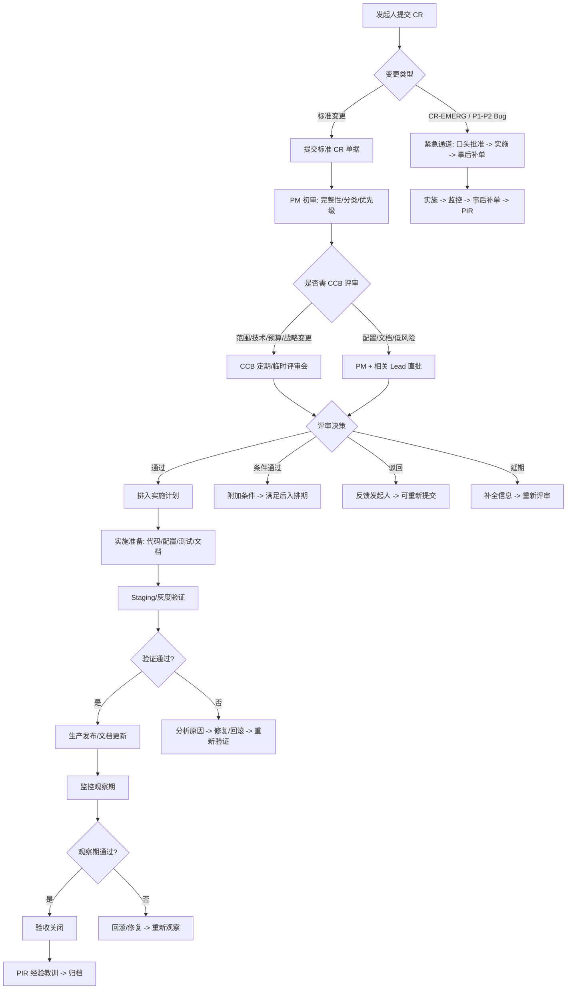

# 变更请求模板与流程

> **文档版本**: 1.0  
> **文档状态**: 生效中  
> **最后更新**: 2026-08-25  
> **文档责任人**: 项目经理  
> **适用范围**: 所有项目范围变更、技术方案变更、配置变更、文档变更  
> **关联文档**: [PROJECT_CHARTER.md](PROJECT_CHARTER.md)、[COMMUNICATION_PLAN.md](COMMUNICATION_PLAN.md)、[RISK_REGISTER.md](RISK_REGISTER.md)

---

## 1. 变更管理概述

### 1.1 目的
建立标准化的变更请求、评审、批准、实施、验证、关闭全流程，确保：
- 所有变更可追溯、可审计
- 变更影响充分评估（进度、成本、质量、风险、范围）
- 变更实施受控、可回滚
- 干系人及时知情、决策透明

### 1.2 变更类型分类

| 变更类型 | 代码 | 定义 | 典型示例 | 评审层级 |
|----------|------|------|----------|----------|
| **范围变更** | CR-SCOPE | 项目边界、交付物、功能增减 | 新增模块、删除功能、调整验收标准 | CCB (变更控制委员会) |
| **技术方案变更** | CR-TECH | 架构、技术选型、数据模型、接口契约 | 数据库迁移、API 破坏性变更、中间件替换 | Tech Lead + PM |
| **配置/参数变更** | CR-CONFIG | 环境变量、阈值、限流参数、定时任务表达式 | 告警阈值调整、限流 QPS 修改、Cron 表达式 | DevOps Lead |
| **文档变更** | CR-DOC | 需求文档、设计文档、运维手册、API 规范 | ARCHITECTURE.md 更新、API 文档变更 | 文档 Owner |
| **缺陷修复** | CR-BUG | 生产/测试环境缺陷修复 | P1/P2 热修复、回归缺陷 | Tech Lead (P1/P2 直推) |
| **紧急变更** | CR-EMERG | 生产故障止血、安全漏洞补丁、合规强制要求 | 回滚部署、紧急打补丁、证书更新 | 紧急通道 (事后补单) |

---

## 2. 变更请求单模板 (Change Request Form)

### 2.1 标准变更请求单 (CR-SCOPE / CR-TECH / CR-CONFIG / CR-DOC)

```markdown
# 变更请求单 (Change Request Form)

## 1. 基本信息
| 字段 | 内容 |
|------|------|
| **CR 编号** | CR-YYYYMMDD-XXX (自动生成) |
| **变更标题** | 简述变更核心内容 (≤ 50 字) |
| **变更类型** | ☐ CR-SCOPE ☐ CR-TECH ☐ CR-CONFIG ☐ CR-DOC ☐ CR-BUG ☐ CR-EMERG |
| **优先级** | ☐ P0 (立即) ☐ P1 (本周) ☐ P2 (本迭代) ☐ P3 (下迭代) |
| **发起人** | 姓名 / 角色 / 日期 |
| **受影响模块** | 后端 API / 前端 Dashboard / 同步引擎 / 规则引擎 / 基础设施 / 文档 / 其他 |
| **关联 Issue/PR** | GitHub Issue #xxx, PR #xxx, Linear Ticket ID |

## 2. 变更描述
### 2.1 现状描述
[描述当前系统行为、配置、文档状态，附截图/链接]

### 2.2 期望状态
[描述变更后的目标状态、预期行为]

### 2.3 变更原因/业务驱动
- [ ] 业务新需求
- [ ] 技术债偿还/重构
- [ ] 性能优化
- [ ] 安全合规要求
- [ ] 缺陷修复
- [ ] 成本优化
- [ ] 其他: _______

### 2.4 变更范围详细清单
| 变更项 | 当前值 | 目标值 | 影响文件/组件 | 备注 |
|--------|--------|--------|---------------|------|
| 示例: 告警阈值 | 100 | 80 | config/alerts.yaml, alertApi | 降低误报率 |

## 3. 影响评估
### 3.1 进度影响
- 预估工时: ___ 人天
- 影响里程碑: ☐ 无 ☐ M8 验收 ☐ Phase 2 启动 ☐ 其他: _____
- 是否需延期: ☐ 是 (___ 天) ☐ 否

### 3.2 成本影响
- 额外人力成本: ___ 人天 × ___ 元/天 = ___ 元
- 基础设施成本: ☐ 无变化 ☐ 新增 ___ 元/月 ☐ 减少 ___ 元/月
- 许可证/第三方服务: ☐ 无变化 ☐ 新增: _____

### 3.3 质量影响
- 测试覆盖: ☐ 需新增单测 ☐ 需新增集成测试 ☐ 需回归测试 ☐ 无影响
- 代码覆盖率: ☐ 预期维持 ☐ 可能下降 (需补测)
- 性能基线: ☐ 无影响 ☐ 可能下降 (需压测验证)

### 3.4 安全/合规影响
- 敏感数据: ☐ 无涉及 ☐ 新增加密 ☐ 脱敏处理
- 合规审计: ☐ 无需 ☐ 需重新审计 ☐ 仅记录
- 数据安全法/广告法: ☐ 合规 ☐ 需法务确认

### 3.5 风险影响
| 风险点 | 概率 | 影响 | 缓解措施 | 应急预案 |
|--------|------|------|----------|----------|
| 示例: 回滚困难 | 中 | 高 | 灰度发布 + 观察 1 小时 | 15 分钟内回滚脚本 |

### 3.6 依赖与冲突
- 依赖前置变更: CR-______ (必须先实施)
- 冲突变更: CR-______ (互斥，需协调)
- 并行变更: CR-______ (可合并发布)

## 4. 实施计划
### 4.1 实施步骤
| 步骤 | 动作描述 | 责任人 | 预计工时 | 完成标准 | 回滚方案 |
|------|----------|--------|----------|----------|----------|
| 1 | 代码变更/配置修改 | | | 代码合入/配置生效 | Git revert / 配置回滚 |
| 2 | 单元测试/自动化测试 | | | CI 绿色 | - |
| 3 | 灰度/Staging 验证 | | | 冒烟测试通过 | 回滚部署 |
| 4 | 生产发布/文档更新 | | | 监控正常/文档发布 | 回滚/文档回滚 |
| 5 | 监控观察期 (___ 小时) | | | 关键指标正常 | 立即回滚 |

### 4.2 资源需求
- 开发: ___ 人天
- 测试: ___ 人天
- 运维/发布: ___ 人天
- 评审/会议: ___ 小时

### 4.3 时间窗口
- 期望实施时间: YYYY-MM-DD HH:MM ~ HH:MM (CST)
- 发布窗口: ☐ 正常发布窗口 (工作日 10:00-18:00) ☐ 非高峰窗口 ☐ 紧急窗口
- 冻结期避让: ☐ 无冲突 ☐ 需避让: _______

## 5. 变更评审记录
| 评审角色 | 评审人 | 评审意见 (通过/驳回/条件通过) | 签名/确认 | 日期 |
|----------|--------|-------------------------------|-----------|------|
| 技术负责人 | | | | |
| 产品负责人 | | | | |
| 项目经理 | | | | |
| DevOps 负责人 | | | | |
| QA 负责人 | | | | |
| 执行发起人 (P0/范围变更) | | | | |

**评审结论**: ☐ 通过 ☐ 条件通过 (见附件条件) ☐ 驳回 (原因: _______) ☐ 延期评审

## 6. 实施记录
| 实施阶段 | 实际开始时间 | 实际结束时间 | 执行人 | 实际结果 | 偏差说明 |
|----------|--------------|--------------|--------|----------|----------|
| 开发/配置 | | | | | |
| 测试验证 | | | | | |
| 发布部署 | | | | | |
| 监控观察 | | | | | |

## 7. 验收与关闭
### 7.1 验收标准确认
- [ ] 功能验收通过 (关联测试用例: ______)
- [ ] 性能指标达标 (关联压测报告: ______)
- [ ] 安全扫描通过 (Trivy/Snyk 报告: ______)
- [ ] 文档同步完成 (更新文档: ______)
- [ ] 监控告警正常 (Grafana/PagerDuty: ______)
- [ ] 回滚演练完成 (如适用: ______)

### 7.2 关闭确认
| 角色 | 姓名 | 确认签名 | 日期 |
|------|------|----------|------|
| 验收人 (QA/PO) | | | |
| 项目经理 | | | |
| 技术负责人 | | | |

**关闭日期**: ________  
**最终状态**: ☐ 成功关闭 ☐ 部分实施 (说明: ______) ☐ 回滚关闭 (原因: ______)

---

## 7.3 经验教训 (Post-Implementation Review)
- 什么做得好？
- 什么可以改进？
- 遗留问题/技术债：
- 知识沉淀 (文档/脚本/最佳实践)：

---

## 2.2 紧急变更简化单 (CR-EMERG / CR-BUG P1/P2)

```markdown
# 紧急变更单 (Emergency Change Request)

## 1. 紧急信息
| 字段 | 内容 |
|------|------|
| **EC 编号** | EC-YYYYMMDD-XXX |
| **触发时间** | YYYY-MM-DD HH:MM CST |
| **触发来源** | ☐ PagerDuty 告警 ☐ 客户投诉 ☐ 内部巡检 ☐ 安全扫描 ☐ 其他 |
| **严重级别** | ☐ P1 (系统不可用/数据丢失) ☐ P2 (核心功能异常/SLA 违约) |
| **影响范围** | 受影响用户数: ___ | 受影响功能: ______ | 预估损失: ______ |
| **发起人** | 姓名 / 角色 / 电话 |

## 2. 问题描述
- 故障现象:
- 根因假设:
- 已采取措施:

## 3. 紧急变更方案
| 变更项 | 当前值 | 紧急修正值 | 风险等级 | 回滚方案 |
|--------|--------|------------|----------|----------|
| | | | ☐ 低 ☐ 中 ☐ 高 | |

## 3. 审批快速通道
| 角色 | 确认人 | 确认方式 | 时间 |
|------|--------|----------|------|
| 技术负责人 (必选) | | ☐ WeCom 语音 ☐ 电话 ☐ 当面 | |
| 项目经理 (P1 必选) | | ☐ WeCom 语音 ☐ 电话 ☐ 当面 | |
| 执行发起人 (仅 P1 全站/数据丢失) | | ☐ 电话 ☐ 当面 | |

**口头批准有效，事后 24 小时内补全标准 CR 单据**

## 4. 实施与结果
| 步骤 | 操作 | 时间 | 执行人 | 结果 |
|------|------|------|--------|------|
| 1 | | | | |
| 2 | | | | |
| 3 | | | | |

**最终结果**: ☐ 恢复正常 ☐ 部分恢复 (需后续) ☐ 失败回滚

## 6. 事后补单
- [ ] 标准 CR 单据已补全 (CR 编号: ______)
- [ ] 根因分析 (RCA) 已完成 (链接: ______)
- [ ] 改进措施已录入风险登记/行动项
```

---

## 3. 变更控制委员会 (CCB)

### 3.1 CCB 组成

| 角色 | 人员 | 职责 | 否决权 |
|------|------|------|--------|
| **主席** | 项目经理 | 主持会议、汇总意见、最终裁决 | 是 |
| **技术委员** | 技术负责人 | 技术可行性、架构影响、技术债评估 | 是 (技术层面) |
| **产品委员** | 产品负责人 | 业务价值、优先级、用户影响 | 是 (业务层面) |
| **运维委员** | DevOps 负责人 | 部署风险、运维负载、回滚可行性 | 是 (运维层面) |
| **质量委员** | QA 负责人 | 测试覆盖、质量门禁、回归风险 | 否 (建议权) |
| **发起人代表** | 执行发起人/指定代表 | 预算、战略对齐、重大风险裁决 | 是 (战略/预算层面) |

### 3.2 评审会议机制

| 会议类型 | 频率 | 召集条件 | 时长 | 参会最低配额 |
|----------|------|----------|------|--------------|
| **定期评审会** | 每周三 15:00 | 有待评审 CR ≥ 1 | 30-60 分钟 | 主席 + 技术委员 + 产品委员 |
| **临时评审会** | 随需召集 | P0 变更、范围变更、预算超支 | 15-30 分钟 | 主席 + 相关委员 |
| **紧急评审** | 即时 | CR-EMERG、P1 故障止血 | 5-10 分钟 | 技术负责人 + PM (口头批准) |

### 3.3 评审决策标准

| 决策 | 条件 | 后续动作 |
|------|------|----------|
| **通过** | 影响可控、收益>成本、风险可接受、资源可用 | 进入实施计划排期 |
| **条件通过** | 需满足特定条件 (补测试、补文档、分阶段实施、增加监控) | 条件满足后自动生效 |
| **驳回** | 风险不可控、收益<成本、与战略冲突、资源不足 | 记录理由、反馈发起人、可重新提交 |
| **延期评审** | 信息不足、依赖未就绪、关键人缺席 | 补全信息后重新提交评审 |

---

## 4. 变更实施与发布流程



---

## 5. 变更相关指标与度量

| 指标 | 目标 | 统计周期 | 负责人 |
|------|------|----------|--------|
| 变更通过率 | ≥ 90% | 月度 | PM |
| 紧急变更占比 | ≤ 10% | 月度 | PM |
| 变更平均周期 (提交→关闭) | 标准 ≤ 5 天, 紧急 ≤ 4 小时 | 月度 | PM |
| 变更失败率 (需回滚/引发故障) | ≤ 5% | 月度 | DevOps |
| 变更文档完整率 | 100% | 月度 | PM |
| 未评审直接实施率 | 0% (除紧急) | 月度 | PM |

---

## 6. 变更请求单编号规则

| 格式 | 示例 | 说明 |
|------|------|------|
| CR-YYYYMMDD-XXX | CR-20260825-001 | 标准变更，按日期顺序编号 |
| EC-YYYYMMDD-XXX | EC-20260825-001 | 紧急变更，独立编号 |
| CR-BUG-YYYYMMDD-XXX | CR-BUG-20260825-001 | 缺陷修复关联变更 |

---

## 7. 附录

### 7.1 常用变更检查清单 (Checklist)

**提交前自检**:
- [ ] 变更标题清晰、类型正确
- [ ] 变更原因明确、业务驱动明确
- [ ] 影响评估完整 (进度/成本/质量/安全/风险)
- [ ] 实施计划具体、有回滚方案
- [ ] 关联 Issue/PR 已关联
- [ ] 已自测/预验证通过

**评审前准备**:
- [ ] CR 单据完整、格式规范
- [ ] 影响评估有数据支撑 (非主观)
- [ ] 实施计划含时间窗口、资源、回滚
- [ ] 关联依赖/冲突变更已识别

**实施前确认**:
- [ ] 代码/配置已合入、CI 绿色
- [ ] Staging/测试环境验证通过
- [ ] 发布窗口确认、相关方知情
- [ ] 监控仪表盘已准备、告警规则就绪
- [ ] 回滚脚本/方案已就绪、可一键执行

**发布后确认**:
- [ ] 关键指标监控正常 (延迟/错误率/吞吐/业务指标)
- [ ] 告警规则生效、无误报/漏报
- [ ] 文档同步更新、版本号更新
- [ ] 回滚方案仍有效 (未因变更失效)

### 7.2 相关模板链接
- [标准变更请求单模板](.github/ISSUE_TEMPLATE/change-request.md) (建议配置为 GitHub Issue Template)
- [紧急变更单模板](.github/ISSUE_TEMPLATE/emergency-change.md)
- [PIR 经验教训模板](.github/ISSUE_TEMPLATE/post-implementation-review.md)

---

## 8. 修订记录

| 版本 | 日期 | 变更作者 | 变更摘要 | 审批人 |
|------|------|----------|----------|--------|
| 1.0 | 2026-08-25 | 项目经理 | 初版创建，包含标准/紧急变更单模板、CCB 机制、流程图、指标 | 执行发起人 |

---

*本文档为活文档，随项目管理成熟度演进。重大流程变更需经 CCB 评审批准。*