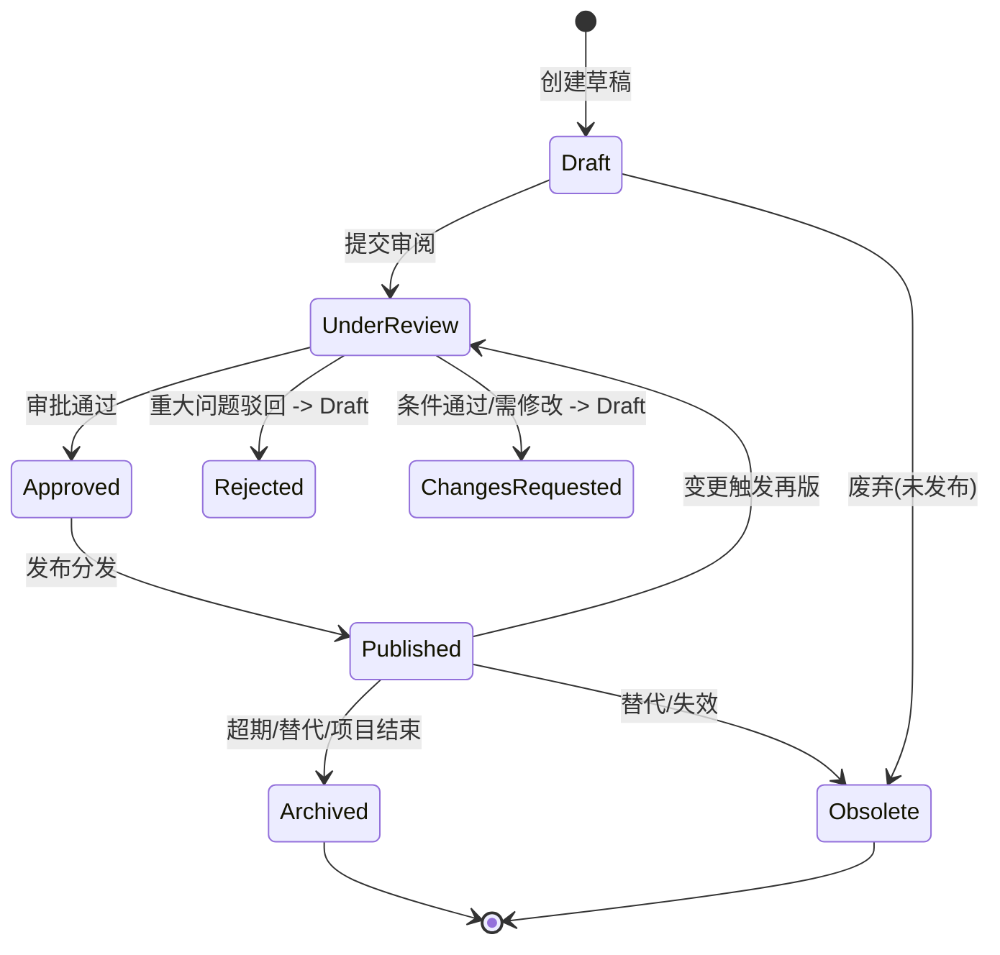
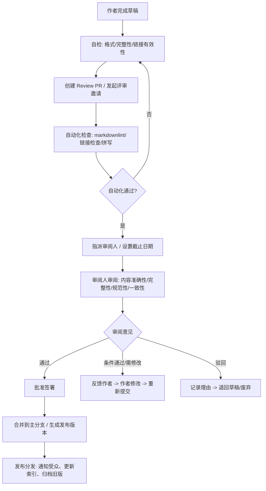
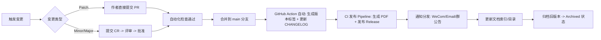

# 文档控制流程

> **文档版本**: 1.0  
> **文档状态**: 生效中  
> **最后更新**: 2026-08-25  
> **文档责任人**: 项目经理  
> **适用范围**: 所有项目文档（需求、设计、API、运维、测试、风险、沟通、质量等）  
> **关联文档**: [PROJECT_CHARTER.md](PROJECT_CHARTER.md)、[COMMUNICATION_PLAN.md](COMMUNICATION_PLAN.md)、[QUALITY_PLAN.md](QUALITY_PLAN.md)、[README.md](../README.md)

---

## 1. 文档控制概述

### 1.1 目的
建立标准化的文档全生命周期管理流程，确保：
- 文档版本受控、变更可追溯
- 审阅批准流程规范、有据可查
- 发布分发及时、受众明确
- 归档保存合规、可检索
- 废弃清理及时、无遗留风险

### 1.2 适用文档范围

| 文档类别 | 典型文档 | 管控级别 | 审批要求 |
|----------|----------|----------|----------|
| **核心治理类** | PROJECT_CHARTER.md、ROADMAP.md、COMMUNICATION_PLAN.md | 最高 | 执行发起人签字 |
| **架构设计类** | ARCHITECTURE.md、DESIGN.md、FRONTEND_DESIGN.md、ADR/* | 高 | Tech Lead + PM |
| **接口规范类** | INTERNAL-API-SPEC.md、EXTERNAL-API-SPEC.md、openapi.yaml | 高 | Backend Lead + Frontend Lead |
| **运维操作类** | RUNBOOK.md、SECURITY_HARDENING.md、应急预案 | 高 | DevOps Lead + Tech Lead |
| **质量测试类** | TEST_STRATEGY.md、TEST_PLAN.md、QUALITY_PLAN.md | 中 | QA Lead + PM |
| **风险合规类** | RISK_REGISTER.md、INCIDENTS.md、CHANGE_REQUEST_TEMPLATE.md | 高 | PM + 相关 Lead |
| **需求规格类** | REQUIREMENTS.md、用户故事、验收标准 | 中 | PM + 相关 Lead |
| **开发规范类** | 编码规范、Git 规范、分支策略、Code Review 清单 | 中 | Tech Lead |
| **会议记录类** | 评审会纪要、复盘会纪要、决策记录 | 低 | 会议主持人 |
| **临时/草稿类** | 设计草稿、调研报告、Spike 报告 | 低 | 作者自管 |

---

## 2. 文档生命周期状态机



### 2.1 状态定义

| 状态 | 定义 | 入口条件 | 出口条件 | 权限 |
|------|------|----------|----------|------|
| **Draft (草稿)** | 编写中、未正式提交审阅 | 作者创建 | 提交审阅 / 废弃 | 作者读写 |
| **Under Review (审阅中)** | 正式提交，等待审阅人审阅 | 提交审阅 PR | 全部审批通过 / 驳回 / 要求修改 | 审阅人只读+评论，作者只读 |
| **Changes Requested (需修改)** | 审阅通过但有条件/需修改 | 审阅人要求修改 | 作者修改完成 -> 重新提交审阅 | 作者读写，审阅人只读 |
| **Rejected (驳回)** | 重大方向错误、不符合规范、被否决 | 审阅人驳回 | 重大重写 -> Draft / 废弃 | 只读存档 |
| **Approved (审批通过)** | 所有必选审批人通过 | 最后一位审批人批准 | 发布 / 归档 | 只读 |
| **Published (已发布)** | 正式版本，分发到目标受众 | 发布动作执行 | 新版本发布 / 归档 / 废弃 | 全员只读，受众可见 |
| **Archived (已归档)** | 历史版本、仅作参考 | 新版本发布 / 项目阶段结束 / 保留期满 | 永久保存 / 销毁 | 只读，受限访问 |
| **Obsolete (已废弃)** | 明确标记不再使用、不应被引用 | 替代文档发布 / 项目取消 / 强制废弃 | 永久保存 / 销毁 | 只读，显著标记废弃 |

---

## 3. 文档编号与版本规范

### 3.1 文档编号规则

| 格式 | 示例 | 说明 |
|------|------|------|
| `DOC-{类别代码}-{序号}-v{版本}` | DOC-GOV-001-v2.0 | 正式文档 |
| `DRAFT-{类别代码}-{序号}-v{版本}-draft` | DRAFT-TECH-003-v0.3-draft | 草稿/审阅中 |
| `ARCHIVE-{类别代码}-{序号}-v{版本}-{日期}` | ARCHIVE-GOV-001-v1.0-20260825 | 归档版本 |

**类别代码表**:
| 代码 | 类别 | 说明 |
|------|------|------|
| GOV | 治理类 | 章程、路线图、沟通计划 |
| TECH | 技术类 | 架构、设计、ADR |
| API | 接口类 | API 规范、OpenAPI |
| OPS | 运维类 | 运维手册、应急预案 |
| QA | 质量类 | 测试策略、测试计划 |
| RISK | 风险类 | 风险登记、变更模板 |
| REQ | 需求类 | 需求规格、用户故事 |
| DEV | 开发类 | 编码规范、Git 规范 |

### 3.2 版本号规范 (SemVer for Docs)

| 版本类型 | 格式 | 触发条件 | 示例 |
|----------|------|----------|------|
| **Major** | X.0.0 | 结构重组、核心章节重写、适用范围变更、废弃重写 | 1.0.0 → 2.0.0 |
| **Minor** | X.Y.0 | 新增章节、重要内容更新、流程优化、新增模板 | 1.0.0 → 1.1.0 |
| **Patch** | X.Y.Z | 文字修正、格式调整、链接修复、拼写纠错、链接更新 | 1.0.0 → 1.0.1 |
| **Draft** | 0.Y.Z / X.Y.Z-draft | 草稿/审阅中版本 | 0.1.0, 1.2.0-draft |

---

## 4. 审阅与批准流程

### 4.1 审阅角色矩阵 (RACI)

| 文档类别 | 作者 (R) | 同级审阅 (C) | 技术审阅 (C) | 业务审阅 (C) | 批准人 (A) | 知情 (I) |
|----------|----------|--------------|--------------|--------------|------------|----------|
| 核心治理类 | PM | Tech Lead | Tech Lead | PM | 执行发起人 | 全员 |
| 架构设计类 | Tech Lead | 架构师/资深工程师 | Tech Lead | PM | Tech Lead | Dev Team |
| 接口规范类 | Backend Lead | Frontend Lead | Tech Lead | PM | Backend Lead + Frontend Lead | Dev Team |
| 运维操作类 | DevOps Lead | 运维工程师 | Tech Lead | PM | DevOps Lead | 运维团队 |
| 质量测试类 | QA Lead | 测试工程师 | Tech Lead | PM | QA Lead | Dev Team |
| 风险合规类 | PM | 相关 Lead | 安全负责人 | 法务/合规 | PM | 全员 |
| 需求规格类 | PM | 业务分析师 | Tech Lead | 业务方 | PM | Dev Team |

### 4.2 审阅流程步骤



### 4.3 审阅时效要求

| 文档类别 | 标准审阅周期 | 加急审阅周期 | 审阅人最低配额 |
|----------|--------------|--------------|----------------|
| 核心治理类 | 3 个工作日 | 1 个工作日 | 3 人 (Tech Lead, PM, Sponsor) |
| 架构设计类 | 2 个工作日 | 1 个工作日 | 2 人 (Tech Lead, 架构师) |
| 接口规范类 | 2 个工作日 | 4 小时 | 2 人 (Backend Lead, Frontend Lead) |
| 运维操作类 | 2 个工作日 | 4 小时 | 2 人 (DevOps Lead, Tech Lead) |
| 其他类别 | 3 个工作日 | 1 个工作日 | 1-2 人 |

> **加急条件**: 生产故障相关、合规截止日期、发布阻断、安全漏洞

### 4.4 审阅检查清单

| 检查项 | 核心治理 | 架构设计 | 接口规范 | 运维操作 | 质量测试 | 通用要求 |
|--------|----------|----------|----------|----------|----------|----------|
| 文档编号/版本规范 | ✅ | ✅ | ✅ | ✅ | ✅ | ✅ |
| 目录结构完整 | ✅ | ✅ | ✅ | ✅ | ✅ | ✅ |
| 术语定义准确 | ✅ | ✅ | ✅ | ✅ | ✅ | ✅ |
| 内容逻辑自洽 | ✅ | ✅ | ✅ | ✅ | ✅ | ✅ |
| 关联文档引用正确 | ✅ | ✅ | ✅ | ✅ | ✅ | ✅ |
| 格式规范 | ✅ | ✅ | ✅ | ✅ | ✅ | ✅ |
| 链接有效性 | ✅ | ✅ | ✅ | ✅ | ✅ | ✅ |
| 业务目标对齐 | ✅ | | | | ✅ | |
| 技术方案可行性 | | ✅ | | ✅ | | |
| API 契约完整 | | | ✅ | | | |
| 运维可操作性 | | | | ✅ | | |
| 测试覆盖/策略 | | | | | ✅ | |
| 合规/安全要求 | ✅ | | ✅ | ✅ | ✅ | |
| 变更记录完整 | ✅ | ✅ | ✅ | ✅ | ✅ | ✅ |
| 审批签署完整 | ✅ | ✅ | ✅ | ✅ | ✅ | ✅ |

---

## 5. 发布与分发管理

### 5.1 发布渠道与权限

| 文档类别 | 发布位置 | 访问权限 | 通知方式 | 归档位置 |
|----------|----------|----------|----------|----------|
| 核心治理类 | GitHub Repo `docs/` + Confluence | 全员只读 | WeCom 群公告 + Email | GitHub Release + Confluence 归档空间 |
| 架构设计类 | GitHub Repo `docs/` + Confluence | 全员只读 | WeCom #dev 群通知 | GitHub Release + Confluence |
| 接口规范类 | GitHub Repo `docs/` + Swagger UI | Dev Team 只读 | WeCom #dev 群 + PR 通知 | GitHub Release + Swagger 历史版本 |
| 运维操作类 | GitHub Repo `docs/` + 内部 Wiki | 运维+Dev Team 只读 | WeCom #ops 群 | GitHub Release + 内部 Wiki 版本库 |
| 质量测试类 | GitHub Repo `docs/` | Dev+QA Team 只读 | WeCom #qa 群 | GitHub Release |
| 风险合规类 | GitHub Repo `docs/` (加密敏感) | 核心成员只读 | WeCom 私密群/加密邮件 | 加密归档 |
| 其他 | GitHub Repo `docs/` | 按需 | 按需 | GitHub Release |

### 5.2 发布检查清单

- [ ] 文档编号、版本号、日期、作者、状态字段完整
- [ ] 变更记录表已更新（版本、日期、作者、变更摘要）
- [ ] 所有审批签署已完成（电子签名/Commit 签名/邮件确认）
- [ ] 文档格式渲染正常（Markdown 渲染、Mermaid 图表、表格对齐）
- [ ] 所有内部链接有效（相对路径、锚点跳转）
- [ ] 外部链接有效性检查通过（自动化工具）
- [ ] 敏感信息已脱敏/加密（密钥、Token、内网 IP、账号）
- [ ] 已生成 PDF 归档版（如需）
- [ ] 已更新文档索引/目录（README.md、文档地图）
- [ ] 已通知相关受众（WeCom/Email/群公告）
- [ ] 旧版本已归档，标记为 Archived

---

## 6. 变更与版本管理

### 6.1 变更触发条件

| 触发场景 | 变更类型 | 处理流程 |
|----------|----------|----------|
| 业务需求变更 | Minor/Major | 走 CR 流程，关联 CR 编号 |
| 技术方案调整 | Minor/Major | 走 CR 流程，关联 ADR |
| 接口契约变更 | Minor/Major | 走 CR 流程，同步更新 OpenAPI |
| 流程/规范优化 | Minor | PM 直批或简易评审 |
| 文字/格式/链接修正 | Patch | 作者自行提交 PR，自动合并 |
| 发现错误/遗漏 | Patch/Minor | 视严重程度决定流程 |
| 合规/法规更新 | Minor/Major | 必须走合规审阅 |
| 安全漏洞修复 | Patch/Minor | 安全负责人审批 |
| 项目阶段结束/里程碑 | Major | 执行发起人批准 |

### 6.2 版本发布流程



### 6.3 版本历史记录要求

每个文档必须包含 **版本历史表**：

| 版本 | 日期 | 变更作者 | 变更摘要 | 审批人 | 关联 CR/ADR |
|------|------|----------|----------|--------|-------------|
| 2.0 | 2026-08-25 | 项目经理 | 增加成功标准、范围边界、签批记录 | 执行发起人 | CR-20260825-001 |
| 1.0 | 2026-07-01 | 项目经理 | 初版创建 | 执行发起人 | - |

---

## 7. 归档与保留策略

### 7.1 保留期限

| 文档类别 | 在线保留 (Published) | 归档保留 (Archived) | 法律/合规要求 | 销毁授权 |
|----------|----------------------|---------------------|---------------|----------|
| 核心治理类 | 永久 (最新版) | 永久 | 7 年 (公司治理) | 执行发起人 |
| 架构设计类 | 永久 (最新版) | 10 年 | 5 年 (技术资产) | Tech Lead |
| 接口规范类 | 永久 (最新版) | 5 年 | 3 年 (API 变更记录) | Backend Lead |
| 运维操作类 | 永久 (最新版) | 5 年 | 3 年 (运维审计) | DevOps Lead |
| 质量测试类 | 3 年 (最新版) | 5 年 | 3 年 (质量审计) | QA Lead |
| 风险合规类 | 5 年 (最新版) | 10 年 | 7 年 (合规审计) | PM + 法务 |
| 会议记录类 | 1 年 | 3 年 | 1 年 | PM |
| 临时/草稿类 | 不发布 | 1 年 (如有价值) | 无 | 作者 |

### 7.2 归档操作规程

1. **触发条件**: 新版本发布、文档状态变为 Archived/Obsolete、项目阶段结束
2. **归档动作**:
   - GitHub: 创建 Release 标签 `doc-{编号}-v{版本}-{日期}`，附上 PDF/Markdown
   - Confluence: 移动到 `Archive/{年份}/{类别}/` 空间，设置只读权限
   - 内部 Wiki: 移动到 `Archive/` 命名空间
   - 本地/网盘: 备份 PDF 到 `Archive/Docs/{年份}/`
3. **元数据更新**: 文档索引表标记为 `Archived`，记录归档日期、归档人、存储路径
4. **通知**: 文档 Owner、相关审阅人、PM

### 7.3 废弃与销毁

| 废弃触发 | 处理方式 | 保留痕迹 | 销毁授权 |
|----------|----------|----------|----------|
| 完全替代 (新文档覆盖) | 标记 Obsolete，保留只读 | 保留元数据 + 最后版本 PDF | 文档 Owner |
| 项目终止/取消 | 批量归档，标记 Project-End | 完整项目文档包 | PM + Sponsor |
| 法律/合规要求销毁 | 彻底删除（含备份） | 仅保留销毁记录（谁、何时、依据） | 法务 + Sponsor |

---

## 8. 文档质量度量

| 指标 | 目标 | 统计方式 | 频率 | 负责人 |
|-------|------|----------|------|--------|
| 文档覆盖率 (核心类 100%) | 100% | 核心清单 / 实际文档数 | 月度 | PM |
| 文档时效性 (≤ 30 天未更新视为陈旧) | 0 陈旧核心文档 | 最后更新时间 vs 当前日期 | 周度 | PM |
| 审阅及时率 (按时完成审阅) | ≥ 90% | 按时完成 / 总审阅任务 | 月度 | PM |
| 审阅质量 (发现缺陷/总审阅) | ≥ 0.5 个/次 | 审阅意见统计 | 月度 | PM |
| 文档变更响应时间 (Patch ≤ 1天, Minor ≤ 3天) | 100% 达标 | 提交到发布时长 | 月度 | PM |
| 文档检索成功率 (用户能找到) | ≥ 95% | 搜索日志/用户反馈 | 季度 | PM |
| 归档完整率 | 100% | 归档记录 / 应归档文档 | 月度 | PM |

---

## 9. 工具与自动化

### 9.1 推荐工具链

| 环节 | 工具 | 用途 |
|------|------|------|
| 编写/协作 | VS Code + Markdown All in One / Notion / Confluence | 编写、协作、评论 |
| 版本控制 | Git + GitHub | 版本历史、PR 评审、分支保护 |
| 格式检查 | markdownlint + markdown-link-check + cspell | CI 自动化格式/链接/拼写检查 |
| 图表渲染 | Mermaid.js / PlantUML | 架构图、流程图、时序图 |
| 文档站点 | VitePress / Docusaurus / GitHub Pages | 文档门户、搜索、版本切换 |
| PDF 生成 | Pandoc / markdown-pdf | 归档版本生成 |
| 版本发布 | GitHub Actions + Release | 自动化版本标签、CHANGELOG、Release Notes |
| 文档门户 | VitePress 部署到 GitHub Pages / 内网 Nginx | 统一入口、全文搜索、版本切换 |

### 9.2 CI/CD 集成示例

```yaml
# .github/workflows/docs-check.yml
name: Docs Quality Check
on:
  pull_request:
    paths: ['docs/**/*.md']
jobs:
  lint:
    runs-on: ubuntu-latest
    steps:
      - uses: actions/checkout@v4
      - name: markdownlint
        uses: davidanson/markdownlint-cli2-action@v15
      - name: Check links
        uses: gaurav-nelson/github-action-markdown-link-check@v1
      - name: Spell check
        uses: rojopolis/spellcheck-github-actions@0.24
      - name: Validate frontmatter
        run: |
          # 检查必填 frontmatter 字段
          python scripts/validate_frontmatter.py docs/
  build-preview:
    needs: lint
    runs-on: ubuntu-latest
    steps:
      - uses: actions/checkout@v4
      - name: Build VitePress
        run: npm ci && npm run docs:build
      - name: Upload preview
        uses: actions/upload-artifact@v4
        with:
          name: docs-preview
          path: docs/.vitepress/dist
```

---

## 10. 文档模板库

### 10.1 标准文档 Frontmatter 模板

```markdown
---
title: 文档标题
version: 1.0
status: Draft | Under Review | Approved | Published | Archived | Obsolete
last_updated: YYYY-MM-DD
owner: 姓名/角色
reviewers: [@reviewer1, @reviewer2]
approvers: [@approver1]
classification: Public | Internal | Confidential | Restricted
doc_id: DOC-{CODE}-{NNN}
tags: [类别, 关键词1, 关键词2]
related_docs: [链接1, 链接2]
changelog: |
  v1.0 (YYYY-MM-DD): 初版创建 - 作者
---
```

### 10.2 常用文档模板位置
建议在 `.github/templates/docs/` 维护：
```
.github/templates/docs/
├── architecture.md      # 架构设计文档模板
├── adr.md               # ADR 模板
├── api_spec.md          # API 规范模板
├── runbook.md           # 运维手册模板
├── test_plan.md         # 测试计划模板
├── risk_register.md     # 风险登记模板
├── meeting_minutes.md   # 会议纪要模板
└── retro.md             # 复盘模板
```

---

## 11. 培训与合规

### 11.1 新成员文档规范培训
- 入职第 1 周：文档规范、模板使用、Git/PR 流程、审阅规范（1 小时）
- 入职第 2 周：实操演练 - 创建文档、发起 Review、处理反馈（配对练习）
- 考核：独立完成一份文档从草稿到发布全流程

### 11.2 合规审计
- **内部审计**: 季度抽查 20% 文档，检查版本、审批、归档合规性
- **外部审计**: 年度配合 ISO 27001 / SOC2 / 等保测评，提供文档控制证据
- **自查清单**: 每月 PM 自查核心文档状态，填写《文档合规自查表》

---

## 12. 附录

### 12.1 文档索引表模板 (docs/INDEX.md)

```markdown
# 文档索引

| 文档编号 | 文档标题 | 版本 | 状态 | 更新日期 | 作者 | 审批人 | 存储位置 | 备注 |
|----------|----------|------|------|----------|------|--------|----------|------|
| DOC-GOV-001 | 项目章程 | 2.0 | Published | 2026-08-25 | PM | Sponsor | docs/PROJECT_CHARTER.md | |
| DOC-GOV-002 | 项目路线图 | 1.0 | Published | 2026-08-25 | PM | - | docs/ROADMAP.md | |
| DOC-TECH-001 | 架构设计 | 1.2 | Published | 2026-08-20 | Tech Lead | Tech Lead | docs/ARCHITECTURE.md | |
```

### 12.2 常用命令速查

```bash
# 验证所有文档 frontmatter 完整性
python scripts/validate_frontmatter.py docs/

# 检查死链
markdown-link-check docs/**/*.md

# 格式检查
npx markdownlint-cli2 "docs/**/*.md"

# 生成文档索引
python scripts/generate_index.py docs/ > docs/INDEX.md

# 批量生成 PDF 归档
for f in docs/*.md; do pandoc "$f" -o "archive/$(basename "$f" .md).pdf"; done
```

---

## 13. 修订记录

| 版本 | 日期 | 变更作者 | 变更摘要 | 审批人 |
|------|------|----------|----------|--------|
| 1.0 | 2026-08-25 | 项目经理 | 初版创建，包含全生命周期状态机、审阅矩阵、发布流程、归档策略、度量指标、CI 集成 | 执行发起人 |

---

*本文档为活文档，随文档管理成熟度演进。所有文档创建者、审阅者、批准人必须熟悉本流程。*