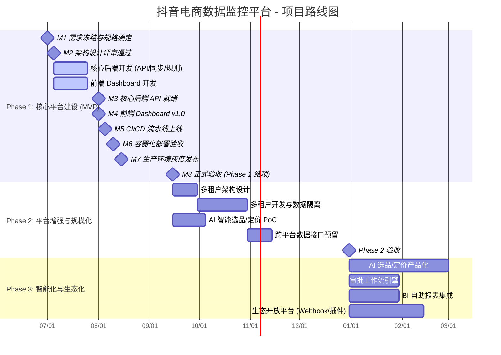
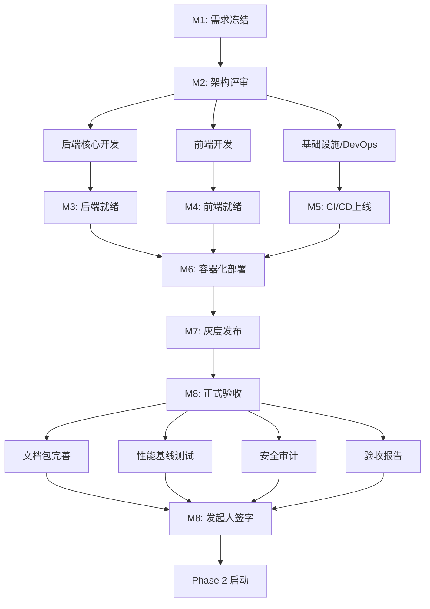

# 项目路线图 (Roadmap)

> **文档版本**: 1.0  
> **文档状态**: 执行中  
> **最后更新**: 2026-08-25  
> **文档责任人**: 项目经理  
> **关联文档**: [PROJECT_CHARTER.md](PROJECT_CHARTER.md)、[RISK_REGISTER.md](RISK_REGISTER.md)、[COMMUNICATION_PLAN.md](COMMUNICATION_PLAN.md)

---

## 1. 路线图概览



---

## 2. Phase 1 详细里程碑 (当前执行阶段)

### 2.1 里程碑时间表

| 里程碑 | 计划日期 | 实际日期 | 状态 | 关键路径 | 责任人 |
|--------|----------|----------|------|----------|--------|
| **M1: 需求冻结** | 2026-07-01 | 2026-07-01 | ✅ 完成 | 需求规格书签字 | PM |
| **M2: 架构评审通过** | 2026-07-05 | 2026-07-05 | ✅ 完成 | ADR-001~005 评审 | Tech Lead |
| **M3: 核心后端就绪** | 2026-08-01 | 2026-08-01 | ✅ 完成 | Flask API + 同步引擎 + 规则引擎 | Backend Lead |
| **M4: 前端 Dashboard v1.0** | 2026-08-01 | 2026-08-01 | ✅ 完成 | React + Ant Design + 响应式 | Frontend Lead |
| **M5: CI/CD 上线** | 2026-08-05 | 2026-08-05 | ✅ 完成 | GitHub Actions 全流程 | DevOps |
| **M6: 容器化部署验收** | 2026-08-10 | 2026-08-24 | ✅ 完成 | Docker Compose + 健康检查 | DevOps |
| **M7: 灰度发布** | 2026-08-15 | 2026-08-24 | ✅ 完成 | 生产灰度 1 周零 P1 | DevOps + PM |
| **M8: 正式验收 (Phase 1 结项)** | **2026-09-15** | **进行中** | 🔄 进行中 | **文档包 + 验收报告 + 发起人签字** | **PM** |

### 2.2 M8 剩余关键任务 (截至 2026-08-25)

| 任务编号 | 任务描述 | 计划完成 | 责任人 | 状态 | 备注 |
|----------|----------|----------|--------|------|------|
| T-M8-01 | 完善项目章程、路线图、变更/问题管理文档 | 2026-08-28 | PM | 🔄 进行中 | 本文档包含 |
| T-M8-02 | 补充测试计划、测试用例、缺陷管理流程 | 2026-08-28 | QA Lead | 🔄 进行中 | 需创建 TEST_PLAN.md |
| T-M8-03 | 完善风险登记册细节、应急预案演练 | 2026-08-28 | PM | 🔄 进行中 | 关联 RUNBOOK |
| T-M8-04 | 编写 API OpenAPI 规范文档 | 2026-08-28 | Backend Lead | 🔄 进行中 | 需创建 openapi.yaml |
| T-M8-05 | 文档控制流程建立、审阅批准记录 | 2026-08-28 | PM | 🔄 进行中 | 需创建 DOC_CONTROL.md |
| T-M8-06 | 变更请求模板、问题追踪模板建立 | 2026-08-28 | PM | 🔄 进行中 | 需创建模板文档 |
| T-M8-07 | 生产环境性能基线测试报告 | 2026-09-05 | DevOps + Backend | ⏳ 计划中 | 压测 + 基线 |
| T-M8-08 | 安全渗透测试与合规审计 | 2026-09-10 | DevOps + Security | ⏳ 计划中 | 第三方或内部 |
| T-M8-09 | 验收报告编写、干系人评审会 | 2026-09-12 | PM | ⏳ 计划中 | PPT + 现场演示 |
| T-M8-10 | 执行发起人签字、Phase 1 正式结项 | 2026-09-15 | PM + Sponsor | ⏳ 计划中 | 正式签字 |

---

## 3. 任务依赖关系图



### 3.1 关键依赖说明

| 依赖关系 | 说明 | 风险缓解 |
|----------|------|----------|
| M3 → M6 | 后端 API 必须就绪才能容器化部署 | API 契约先行，Mock 服务并行开发 |
| M4 → M6 | 前端构建产物需纳入 Docker 镜像 | 前端独立 CI 构建，产物上传制品库 |
| M5 → M6 | CI/CD 必须先跑通才能部署 | Pipeline 先在 Staging 验证 |
| M6 → M7 | 容器部署验收通过才能灰度 | Staging 环境完整回归测试 |
| M7 → M8 | 灰度 1 周零 P1 才能正式验收 | 灰度期间每日巡检、指标监控 |

---

## 4. 资源分配与关键路径

### 4.1 团队资源矩阵 (Phase 1)

| 角色 | 人数 | 投入比例 | 关键任务 | 冲突风险 |
|------|------|----------|----------|----------|
| Backend Developer | 2 | 100% | API、同步引擎、规则引擎、单测 | 无 |
| Frontend Developer | 1 | 100% | Dashboard、组件库、响应式 | 单点依赖 (Bus Factor=1) |
| DevOps Engineer | 1 | 100% | CI/CD、部署、监控、安全 | 单点依赖 |
| QA Engineer | 1 | 80% | 测试策略、自动化、缺陷管理 | 需前置开发完成 |
| Project Manager | 1 | 100% | 进度/风险/沟通/文档 | 多线程管理 |

### 4.2 关键路径分析

```
关键路径: M1 → M2 → DevBackend(20d) → M3 → M6(5d) → M7(7d) → M8
总工期: 32 天 (不含缓冲)
当前进度: M6 已完成，M7 已完成，M8 进行中
剩余关键任务: 文档包完善 → 验收报告 → 发起人签字
预计完成: 2026-09-15 (按计划)
```

---

## 5. Phase 2 & 3 前瞻规划

### 5.1 Phase 2: 平台增强与规模化 (2026-10 ~ 2026-12)

| Epic | 用户故事 | 预估工时 | 依赖 | 优先级 |
|------|----------|----------|------|--------|
| **多租户架构** | 作为平台方，希望支持多公司/多品牌数据隔离，实现 SaaS 化 | 6 人周 | Phase 1 核心模块稳定 | P0 |
| **数据权限模型** | RBAC + 数据范围隔离，支持品牌/店铺/运营角色 | 3 人周 | 多租户架构 | P0 |
| **AI 选品 PoC** | 基于历史销量/趋势/竞品，推荐高潜商品 | 4 人周 | 历史数据积累 ≥ 3 个月 | P1 |
| **智能定价 PoC** | 基于弹性系数/竞品价格/库存，建议最优价格区间 | 4 人周 | 价格历史数据、竞品监控 | P1 |
| **跨平台接口预留** | 统一 Adapter 接口，预留快手/淘宝/京东扩展 | 2 人周 | 统一 Adapter 模式 | P2 |

### 5.2 Phase 3: 智能化与生态化 (2027 H1)

| Epic | 目标 | 预估工时 | 前置条件 |
|------|------|----------|----------|
| AI 选品/定价产品化 | 从 PoC 到生产可用，准确率 ≥ 75% | 8 人周 | Phase 2 PoC 成功 |
| 审批工作流引擎 | 接入企业 OA，告警配置/规则变更走审批 | 4 人周 | 现有 OA 系统 API 开放 |
| BI 自助报表 | 接入 Apache Superset/Metabase，运营自建报表 | 4 人周 | 数据仓库建设完成 |
| 生态开放平台 | Webhook/插件市场，第三方系统集成 | 6 人周 | OpenAPI 规范完善 |

---

## 6. 发布节奏与版本策略

### 6.1 版本号规范 (SemVer)
- **Major**: 架构重构、不兼容 API 变更、重大架构升级
- **Minor**: 新功能发布、向后兼容的 API 增强
- **Patch**: Bug 修复、安全补丁、配置调整

### 6.2 发布节奏

| 发布类型 | 频率 | 流程 | 示例 |
|----------|------|------|------|
| **Major Release** | 每季度 1 次 | 完整回归测试 + 灰度 1 周 + 文档更新 | v2.0.0 (多租户上线) |
| **Minor Release** | 每月 1 次 | 自动化测试 + 灰度 1 天 | v1.1.0 (新增创作者看板) |
| **Patch Release** | 按需 (周级) | 冒烟测试 + 直接部署 | v1.0.1 (修复同步超时) |
| **Hotfix** | 紧急 (P1 故障) | 直接部署 + 事后补测 | v1.0.1-hotfix.1 |

### 6.3 里程碑版本映射

| 里程碑 | 版本号 | 发布类型 | 关键特性 |
|--------|--------|----------|----------|
| M3 | v0.5.0 | Internal Alpha | 核心 API 就绪 |
| M4 | v0.6.0 | Internal Alpha | 前端 Dashboard 可用 |
| M6 | v0.9.0 | Release Candidate | 容器化部署就绪 |
| M7 | v0.9.5 | Pre-Production | 灰度验证中 |
| **M8** | **v1.0.0** | **GA (General Availability)** | **正式验收** |
| Phase 2 完成 | v2.0.0 | Major | 多租户 + AI PoC |

---

## 7. 风险与缓冲管理

### 7.1 进度风险缓冲

| 风险点 | 影响天数 | 缓冲策略 | 触发条件 |
|--------|----------|----------|----------|
| 文档包完善延期 | 3-5 天 | 提前并行写作、模板化 | T-7 天未完成 50% |
| 性能测试环境冲突 | 2-3 天 | 预留 Staging 专用时段 | 压测排期冲突 |
| 安全审计整改 | 5-10 天 | 预留整改 Sprint、预扫描 | 审计发现 Critical/High |
| 发起人签字排期 | 2-3 天 | 提前 2 周预约、预发阅读版 | 发起人日程冲突 |

### 7.2 关键决策点

| 决策点 | 决策内容 | 负责人 | 最晚决策日期 | 备选方案 |
|--------|----------|--------|--------------|----------|
| DP-01 | 是否推迟 M8 验收至 9 月底 | PM + Sponsor | 2026-09-01 | 分批验收 (核心先行) |
| DP-02 | Phase 2 多租户是否并行开发 | Tech Lead + PM | 2026-09-15 | 顺序开发 (延期 1 月) |
| DP-03 | AI PoC 是否投入专人 | PM + Tech Lead | 2026-10-01 | 外包/暂缓 |

---

## 8. 进度跟踪与汇报

### 8.1 跟踪指标

| 指标 | 目标 | 当前值 | 趋势 | 汇报频率 |
|------|------|--------|------|----------|
| 里程碑按时率 | 100% | 87.5% (7/8) | ⬆️ | 周报 |
| 关键路径偏差 | 0 天 | +14 天 (M6 延期) | ➡️ | 日报 |
| 里程碑交付物完整度 | 100% | 75% | ⬆️ | 周报 |
| 文档完整度 | 100% | 85% | ⬆️ | 周报 |

### 8.2 偏差分析与纠偏

| 偏差项 | 原始计划 | 实际发生 | 偏差 | 原因 | 纠偏措施 |
|--------|----------|----------|------|------|----------|
| M6 容器化部署 | 2026-08-10 | 2026-08-24 | +14 天 | Windows 路径污染、CSP/权限问题 | 已修复、文档化、加入 CI 检查 |

---

## 9. 变更记录

| 版本 | 日期 | 变更作者 | 变更摘要 |
|------|------|----------|----------|
| 1.0 | 2026-08-25 | 项目经理 | 初版创建，包含 Phase 1 详细里程碑、依赖图、Phase 2/3 规划 |

---

## 10. 附录

### 10.1 关键日期汇总表

| 事件 | 日期 | 备注 |
|------|------|------|
| 项目启动 | 2026-07-01 | Kick-off 会议 |
| 需求冻结 | 2026-07-01 | M1 |
| 架构评审 | 2026-07-05 | M2 |
| 核心后端完成 | 2026-08-01 | M3 |
| 前端完成 | 2026-08-01 | M4 |
| CI/CD 上线 | 2026-08-05 | M5 |
| 容器化验收 | 2026-08-10 (实际 08-24) | M6 |
| 灰度发布 | 2026-08-15 (实际 08-24) | M7 |
| **正式验收** | **2026-09-15 (目标)** | **M8** |
| Phase 2 启动 | 2026-10-01 | 规划中 |
| Phase 2 完成 | 2026-12-31 | 目标 |

---

*本路线图为动态文档，随项目进展每周更新。重大变更需经 CCB 评审并更新版本号。*