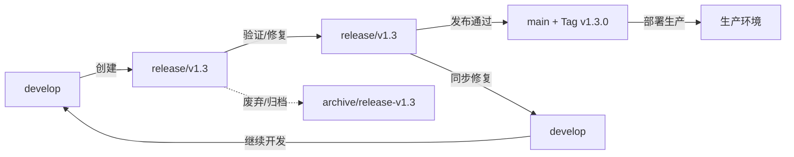

# 分支策略详解

## 1. 策略选型依据

### 1.1 业务场景分析
| 维度 | 现状 | 策略要求 |
|------|------|----------|
| 团队规模 | 10-20 人 | 支持并行开发、代码审查、冲突最小化 |
| 发布节奏 | 月度次版本 + 周度补丁 + 按需热修复 | 支持多版本并行维护、快速热修复 |
| 环境层级 | 开发 → 测试 → 预发布 → 生产 | 分支映射环境、流程可控 |
| 回滚需求 | 分钟级回滚、版本间切换 | Tag 规范、分支可追溯 |
| 合规要求 | 变更可追溯、审计留痕、发布审批 | 保护分支、强制 PR、签名提交 |

### 1.2 策略对比与选型
| 策略 | 优点 | 缺点 | 适用性 | 我方决策 |
|------|------|------|--------|----------|
| **GitHub Flow** | 简单、持续部署、主干开发 | 无版本隔离、不适合多版本维护 | 纯 SaaS、单版本 | ❌ 不适用 |
| **GitFlow** | 版本隔离清晰、发布管理规范 | 分支多、流程重、合并冲突多 | 传统版本发布软件 | ⚠️ 参考 |
| **GitLab Flow** | 环境分支映射、灵活 | 需配合环境策略 | 多环境部署 | ⚠️ 参考 |
| **Trunk-Based Development** | 集成快、冲突少、CI/CD 友好 | 需强 Feature Flag、成熟度高要求 | 高成熟度团队、高频发布 | ⚠️ 部分采用 |
| **混合策略 (GitFlow + GitHub Flow)** | 兼顾版本隔离与持续集成、发布分支隔离、主干持续集成 | 规则相对复杂、需工具化保障 | **我方场景最佳** | ✅ **采用** |

---

## 2. 分支模型详细设计

### 2.1 分支分类与职责

#### 2.1.1 永久分支
| 分支 | 别名 | 来源 | 合并入 | 保护级别 | 触发部署 | 核心原则 |
|------|------|------|--------|----------|----------|----------|
| `main` | `production` | `release/*`、`hotfix/*` | - | 最高 (2 Review + CI + 签名) | 生产环境自动部署 | **永远可部署、仅接受合并、禁止直接推送** |
| `develop` | `integration` | `feature/*`、`bugfix/*`、`hotfix/*`、`release/*` | `main` (发布时) | 高 (1 Review + CI) | 测试/预发布环境自动部署 | **最新集成代码、日常开发基线** |

#### 2.1.2 临时分支
| 分支类型 | 命名规范 | 来源 | 合并入 | 生命周期 | 删除策略 |
|----------|----------|------|--------|----------|----------|
| 功能分支 | `feature/{issue}-{desc}` | `develop` | `develop` | 天~2周 | 合并后删除 |
| 缺陷分支 | `bugfix/{issue}-{desc}` | `develop` | `develop` | 小时~天 | 合并后删除 |
| 紧急修复 | `hotfix/{issue}-{desc}` | `main` | `main`、`develop`、`release/*` | 小时~天 | 合并后删除 |
| 发布分支 | `release/v{M}.{m}` | `develop` | `main`、`develop` | 周~月 | 发布后可选保留/归档 |
| 实验分支 | `experiment/{desc}` | `develop` | `develop` 或废弃 | 天~周 | 定期清理 |

---

## 3. 分支操作规范

### 3.1 功能分支
```bash
# 创建
git checkout develop
git pull origin develop
git switch -c feature/123-user-dashboard

# 开发中同步 (每日推荐)
git fetch origin
git rebase origin/develop

# 提交规范
git add .
git commit -m "feat(dashboard): add user analytics widget
Closes #456"

# 推送与 PR
git push -u origin feature/456-user-dashboard
# 创建 PR: feature/456-user-dashboard → develop
```

**关键规则**:
- ✅ 单一职责：一个分支只做一件事
- ✅ 小步提交：逻辑原子性，便于 Review 和回滚
- ✅ 定期 rebase：每日同步 `develop`，避免大冲突
- ✅ 及时 PR：完成最小可用功能即提 PR，避免长期腐烂
- ❌ 禁止直接 commit 到 `develop`/`main`

### 3.2 发布分支
```bash
# 创建发布分支 (由 Tech Lead 操作)
git checkout develop
git pull origin develop
git switch -c release/v1.3

# 版本号更新 (仅限 release 分支)
npm version minor  # 或手动修改 package.json/pyproject.toml
echo "## v1.3.0\n\n### Features\n- ...\n### Fixes\n- ..." >> CHANGELOG.md
git add . && git commit -m "chore(release): prepare v1.3.0"

# 推送并触发发布流水线
git push -u origin release/v1.3

# 发布分支仅接受 bugfix，禁止新功能
git switch -c bugfix/release-v1.3-fix-login
# 修复...
git push -u origin bugfix/release-v1.3-fix-login
# PR → release/v1.3
```

**发布分支规则**:
- ✅ 仅接受 `bugfix/`、`hotfix/` 合并
- ❌ 严禁合并 `feature/` 新功能
- ✅ 版本号、CHANGELOG 仅在 release 分支维护
- ✅ 发布验证通过后，合并到 `main` 打 Tag，同步回 `develop`

### 3.3 紧急热修复
```bash
# 场景：生产 P0 故障，需分钟级响应
# 1. 从 main 创建
git checkout main
git pull origin main
git switch -c hotfix/789-fix-payment-timeout

# 2. 修复、测试、验证
git commit -m "fix(payment): increase gateway timeout to 30s
Root cause: downstream gateway upgraded to 25s default
Test: add integration test with 28s delay
Fixes #789"

# 4. 双 PR 并行 (或 cherry-pick)
# PR 1: hotfix/789 → main (优先，部署生产)
# PR 2: hotfix/789 → develop (同步修复)
# PR 3: 如有活跃 release/*，同步 cherry-pick

# 部署后清理
git checkout main && git pull
git branch -d hotfix/789-fix-payment-timeout
git push origin --delete hotfix/789-fix-payment-timeout
```

**热修复规则**:
- ✅ 基于 `main` 创建，确保修复基于生产代码
- ✅ 双向同步：`main` 优先部署，`develop` 同步防回归
- ✅ 如有活跃 `release/*`，需同步 `cherry-pick`
- ✅ 修复验证通过前，不合并其他变更

---

## 4. 合并策略与历史管理

### 4.1 合并策略对照表
| 源分支 → 目标分支 | 策略 | 参数 | 理由 |
|------------------|------|------|------|
| `feature/*` → `develop` | **Squash and Merge** | `--squash` | 单次提交，历史整洁，便于回滚 |
| `bugfix/*` → `develop` | **Squash and Merge** | `--squash` | 同理 |
| `hotfix/*` → `main` | **Squash and Merge** | `--squash` | 生产历史简洁，快速回滚 |
| `hotfix/*` → `develop` | **Squash and Merge** | `--squash` | 同步修复，历史整洁 |
| `release/*` → `main` | **Merge Commit (--no-ff)** | `--no-ff` | 保留发布分支完整历史，便于审计 |
| `release/*` → `develop` | **Merge Commit (--no-ff)** | `--no-ff` | 同步发布修复，保留上下文 |

### 4.2 合并操作示例
```bash
# Squash and Merge (GitHub/GitLab UI 或 CLI)
# CLI 模拟:
git checkout develop
git merge --squash feature/123-xxx
git commit -m "feat: add user dashboard (PR #123)"

# Merge Commit --no-ff (发布合并)
git checkout main
git merge --no-ff release/v1.3 -m "chore(release): merge release v1.3.0"

# Cherry-pick 热修复同步
git checkout develop
git cherry-pick <hotfix-commit-hash>  # 保留原作者信息
# 或
git cherry-pick -x <hotfix-commit-hash>  # 追加 "(cherry picked from commit ...)"
```

### 4.3 提交历史规范
| 原则 | 执行方式 |
|------|----------|
| **主分支历史线性** | `main`/`develop` 仅接受 Squash Merge 或 --no-ff Merge，禁止直接推送 |
| **提交粒度** | 功能分支内可自由提交，合并时 Squash 为单次提交 |
| **提交信息** | 合并提交遵循 Conventional Commits，关联 PR/Issue |
| **签名提交** | `main`/`release/*` 强制 GPG 签名 (`git commit -S`) |

---

## 5. 版本发布与分支生命周期

### 5.1 发布类型与分支映射
| 发布类型 | 版本号格式 | 源分支 | 目标分支 | Tag 格式 | 示例 |
|----------|------------|--------|----------|----------|------|
| 主版本 | `v{M+1}.0.0` | `develop` | `release/v{M+1}.0` → `main` | `v{M+1}.0.0` | `v2.0.0` |
| 次版本 | `v{M}.{m+1}.0` | `develop` | `release/v{M}.{m+1}` → `main` | `v{M}.{m+1}.0` | `v1.3.0` |
| 补丁版本 | `v{M}.{m}.{p+1}` | `release/v{M}.{m}` / `hotfix/*` | `main` | `v{M}.{m}.{p+1}` | `v1.2.1` |
| 预发布 | `v{M}.{m}.{p}-rc.{n}` | `release/v{M}.{m}` | `main` (灰度) | `v{M}.{m}.{p}-rc.{n}` | `v1.3.0-rc.1` |
| 紧急修复 | `v{M}.{m}.{p+1}` | `main` | `hotfix/*` → `main` | `v{M}.{m}.{p+1}` | `v1.2.1` |

### 5.2 发布分支生命周期管理


### 5.3 分支清理策略
| 分支状态 | 保留期限 | 处理动作 |
|----------|----------|----------|
| `feature/*` `bugfix/*` 已合并 | 即时 | 合并后自动/手动删除远程分支 |
| `hotfix/*` 已合并 | 即时 | 删除 |
| `release/v{M}.{m}` 已发布 | 90 天 | 归档为 `archive/release-v{M}.{m}` 或删除 |
| `release/v{M}.{m}` 未发布/废弃 | 30 天 | 确认废弃后删除 |
| `experiment/*` | 30 天 | 定期清理，转正则重命名为 `feature/` |
| 长期无活动分支 (>90天) | 定期扫描 | 确认废弃后批量清理 |

---

## 6. 保护规则与自动化

### 6.1 分支保护配置 (GitHub/GitLab)
```yaml
# GitHub Branch Protection Rules (via API/Terraform)
main:
  required_pull_request_reviews:
    required_approving_review_count: 2
    dismiss_stale_reviews: true
    require_code_owner_reviews: true
  required_status_checks:
    strict: true
    contexts:
      - "ci/lint"
      - "ci/test"
      - "ci/type-check"
      - "ci/build"
      - "ci/security-scan"
  enforce_admins: true
  required_signatures: true
  required_linear_history: true
  allow_force_pushes: false
  allow_deletions: false

develop:
  required_pull_request_reviews:
    required_approving_review_count: 1
    dismiss_stale_reviews: true
  required_status_checks:
    strict: true
    contexts:
      - "ci/lint"
      - "ci/test"
      - "ci/type-check"
      - "ci/build"
  allow_force_pushes: false

release/*:
  required_pull_request_reviews:
    required_approving_review_count: 1
  required_status_checks:
    contexts:
      - "ci/lint"
      - "ci/test"
      - "ci/build"
  allow_force_pushes: false
```

### 6.2 自动化流水线触发规则
| 事件 | 触发流水线 | 环境 | 备注 |
|------|-----------|------|------|
| `push` 到 `develop` | CI (Lint/Test/Build/Scan) | 测试环境自动部署 | 每次推送 |
| `push` 到 `release/*` | CI + 发布构建 | 预发布环境自动部署 | 每次推送 |
| `push` 到 `main` | CI + 发布构建 + 部署 | 生产环境 (需人工确认) | Tag 推送触发生产部署 |
| PR `opened`/`synchronize` | CI (快速检查) | - | 快速反馈 |
| `tag push` (v*.*.*) | 发布构建 + 制品发布 | 制品仓库 | 制品不可变 |

---

## 7. 冲突预防与解决

### 7.1 冲突预防最佳实践
| 实践 | 频率/时机 | 说明 |
|------|-----------|------|
| **功能分支定期 rebase develop** | 每日/每半天 | 保持与主线同步，冲突早发现早解决 |
| **小步提交、小 PR** | 每个逻辑单元 | 减少单次合并冲突面，便于 Review |
| **模块/文件所有权** | 长期 | 核心文件设定 Owner，减少跨团队改动冲突 |
| **架构变更先行沟通** | 设计评审阶段 | 大重构前在设计文档/ADR 中达成共识 |
| **避免长期分支** | 分支生命周期 < 2 周 | 长期分支定期 rebase 或拆分 |

### 7.2 冲突解决流程
```bash
# 场景：rebase develop 时冲突
git checkout feature/xxx
git fetch origin
git rebase origin/develop

# 冲突发生
# 1. 查看冲突文件
git status
# 2. 手动解决冲突 (编辑器打开 <<<<<<< >>>>>>> 标记)
# 3. 标记解决
git add <resolved-files>
# 3. 继续 rebase
git rebase --continue

# 若冲突复杂，可选择 merge 代替 rebase
git merge origin/develop  # 产生 merge commit，保留分支历史
```

### 7.3 冲突解决原则
| 原则 | 执行标准 |
|------|----------|
| **保留语义正确性** | 以目标分支 (`develop`/`main`) 逻辑为准，功能分支适配 |
| **保留最新修复** | Bug 修复、安全补丁优先保留 |
| **保留完整功能** | 新功能完整性优于代码风格 |
| **必要时沟通** | 核心模块冲突，必须与原作者/Owner 确认 |
| **测试验证** | 冲突解决后，必须跑通相关测试 |

---

## 8. 迁移与特殊场景

### 8.1 从旧策略迁移
```bash
# 场景：从单分支/简单 GitFlow 迁移到本策略
# 1. 确保 main 为最新生产代码
git checkout main && git pull

# 2. 创建 develop 分支 (如不存在)
git checkout -b develop main
git push -u origin develop

# 3. 保护分支配置 (按 6.1 节配置)

# 4. 现有功能分支逐个 rebase 到 develop
git checkout feature/old-xxx
git rebase origin/develop
# 解决冲突...
git push --force-with-lease origin feature/old-xxx

# 4. 更新 CI/CD、分支保护、文档
# 5. 团队培训、试运行 1-2 个迭代
```

### 8.2 单仓多项目
```bash
# 目录结构
repo/
├── apps/
│   ├── backend/
│   ├── frontend/
│   └── admin/
├── packages/
│   ├── shared-ui/
│   └── shared-utils/
└── infra/

# 分支策略：统一分支模型，通过路径过滤触发对应 CI
# CI 配置示例 (GitHub Actions)
on:
  push:
    paths:
      - 'apps/backend/**'
      - 'packages/shared-utils/**'
    branches: [develop, main, 'release/**']
```

### 8.3 单仓多版本维护
```bash
# 场景：同时维护 v1.x、v2.x 两个主版本
main          → v2.x 生产
release/v1.2  → v1.x 生产维护分支
release/v2.3  → v2.x 预发布
develop       → v2.x 下一版本开发

# 热修复同步策略
hotfix/v1.2.x → release/v1.2 → main (v1.x 生产)
hotfix/v2.x   → main → develop (v2.x 同步)
```

---

## 9. 工具化与自动化

### 9.1 Git 工具配置
```bash
# 全局配置 (~/.gitconfig)
[user]
    name = Your Name
    email = your.email@company.com
    signingkey = YOUR_GPG_KEY_ID

[commit]
    gpgsign = true
    template = ~/.gitmessage.txt

[rebase]
    autoStash = true
    updateRefs = true

[merge]
    conflictstyle = diff3
    ff = only

[pull]
    rebase = true
    ff = only

[push]
    autoSetupRemote = true
    followTags = true

[alias]
    co = checkout
    br = branch -vv
    st = status -sb
    lg = log --oneline --graph --decorate --all -20
    amend = commit --amend --no-edit
    undo = reset --soft HEAD~1
    clean-branches = "!git branch --merged | grep -v '\\*\\|main\\|develop' | xargs -r git branch -d"
```

### 9.2 自动化脚本
```bash
# scripts/git-sync-develop.sh
#!/bin/bash
# 功能：同步 develop 到当前功能分支，自动处理冲突提示
set -euo pipefail

CURRENT_BRANCH=$(git branch --show-current)
if [[ "$CURRENT_BRANCH" =~ ^(main|develop|release/|hotfix/) ]]; then
    echo "❌ 不能在保护分支上运行此脚本"
    exit 1
fi

echo "🔄 同步 develop 到 $CURRENT_BRANCH..."
git fetch origin
git rebase origin/develop || {
    echo "⚠️  Rebase 冲突，请手动解决后运行: git rebase --continue"
    exit 1
}
echo "✅ 同步完成"
```

---

## 10. 监控与治理

### 10.1 分支健康度指标
| 指标 | 目标 | 监控方式 | 告警阈值 |
|------|------|----------|----------|
| 功能分支平均寿命 | < 7 天 | Git API 统计 | > 14 天告警 |
| 并行功能分支数 | < 20 个 | Git API 统计 | > 30 个告警 |
| 合并冲突率 | < 10% | CI 统计 | > 20% 告警 |
| 热修复频率 | < 2 次/周 | Git 统计 | > 5 次/周 告警 |
| 发布分支停留时间 | < 2 周 | Git 统计 | > 4 周告警 |
| 保护分支直接推送尝试 | 0 次 | Git Hook/日志 | > 0 次即告警 |

---

*文档版本: v1.0.0 | 维护者: Tech Lead | 更新周期: 季度*
EOF