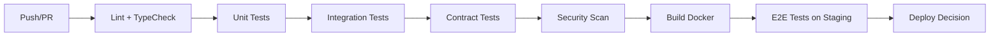

# 测试与质量保障规范

> 本文档整合了测试策略、质量计划、测试报告模板、Code Review 清单，作为项目质量保障的统一参考。

---

## 1. 测试策略

### 1.1 测试金字塔

```
        ┌─────────────┐
        │   E2E/契约  │  ← 少量、高价值、高维护成本
        ├─────────────┤
        │  集成/契约  │  ← 适量、验证模块协作
        ├─────────────┤
        │   单元测试  │  ← 大量、快速、低维护成本
        └─────────────┘
```

| 层级 | 范围 | 工具 | 覆盖率目标 | 执行频率 |
|------|------|------|------------|----------|
| **单元测试** | 纯函数、工具类、Service 逻辑 | pytest / Vitest | 核心模块 ≥ 80% | 每次提交 |
| **集成测试** | 模块间交互、DB 操作、外部 API Mock | pytest + Testcontainers | 核心链路 100% | 每次 PR |
| **契约测试** | API 契约、消息格式 | Pact / pytest-contract | 所有对外 API 100% | 每次 PR |
| **E2E 测试** | 关键用户旅程 | Playwright | 核心场景 100% | 每日/发布前 |
| **性能测试** | 核心接口基线 | Locust / k6 | P99 < 500ms | 每周/发布前 |
| **安全测试** | 依赖/代码/容器扫描 | Trivy / Bandit / Semgrep | 0 Critical/High | 每次构建 |

### 1.2 测试环境矩阵

| 环境 | 用途 | 数据来源 | 部署方式 |
|------|------|----------|----------|
| **本地开发** | 单元/集成测试、调试 | Mock / SQLite | Docker Compose |
| **CI Pipeline** | 全自动化门禁 | Mock / PostgreSQL (Testcontainers) | GitHub Actions |
| **Staging** | E2E/性能/安全/联调 | 生产脱敏数据子集 | K8s / Docker Swarm |
| **生产** | 冒烟/回归/混沌工程 | 真实数据 | K8s |

---

## 2. 质量计划

### 2.1 质量门禁

#### 2.1.1 代码级门禁 (每次提交/PR)
| 检查项 | 频率 | 工具/标准 | 通过标准 |
|--------|------|-----------|----------|
| **代码规范** | 每次 PR | GitLab MR + 至少 1 Approve | 无阻断意见 |
| **静态分析** | 每次提交 | flake8 + black + mypy | 0 errors, 0 warnings |
| **单元测试** | 每次提交 | pytest + pytest-cov | 覆盖率 ≥ 80% (核心 100%) |
| **契约测试** | 每次 PR | pytest-contract | 100% 通过 |
| **依赖扫描** | 每次构建 | Trivy (requirements.txt) | 0 Critical/High |

#### 2.1.2 构建/集成门禁 (每日/每 PR)
| 活动 | 频率 | 工具/标准 | 通过标准 |
|------|------|-----------|----------|
| **构建测试** | 每日/每 PR | pytest-integration (Mock 外部 API) | 100% 通过 |
| **端到端测试** | 每次发布前 | Playwright (自动化/手动) | 核心场景 100% |
| **容器扫描** | 每次构建 | Trivy (fs/config/deps) | 0 Critical/High |
| **镜像扫描** | 每次发布前 | Trivy (Docker image) | 0 Critical/High |
| **性能基线** | 每次发布前 | Locust/k6 压测 | P99 < 500ms、成功率 > 99% |

#### 2.1.3 发布/运维门禁
| 活动 | 频率 | 工具/标准 | 通过标准 |
|------|------|-----------|----------|
| **健康巡检** | 每 5 分钟 | `/api/v1/health` | success=true |
| **冒烟测试** | 每次发布后 | 核心 API 调用 | 核心接口 200 OK |
| **灾备演练** | 季度 | 手动/自动演练 | RTO < 5 分钟 |
| **全量演练** | 半年 | 手动演练 | RPO < 1 小时、RTO < 30 分钟 |

### 2.2 代码覆盖率要求

| 维度 | 覆盖率目标 | 统计单位 |
|------|------------|----------|
| **单元测试** | 核心业务 100%、整体 ≥ 85% | 文件 |
| **集成测试** | 核心链路 100% | 用例数 |
| **契约测试** | 所有对外 API 100% | 用例数 |
| **E2E 测试** | 核心用户旅程 100% | 场景数 |
| **性能测试** | 核心接口基线杈炬爣 | 5-10 个场景 |
| **安全测试** | 0 Critical/High | 总漏洞数 |

### 2.3 代码规范标准

| 语言 | 规范 | 工具 | CI 强制 |
|------|------|------|---------|
| **Python** | PEP 8 + Google Style Docstring | black + flake8 + pydocstyle | 是 |
| **TypeScript** | Airbnb + Prettier | eslint + prettier | 是 |
| **Dockerfile** | Hadolint | hadolint | 是 |
| **YAML** | Yamllint | yamllint | 是 |

#### 2.3.1 代码审查清单 (核心项)
- [ ] 功能实现完全符合需求，无过度设计 (YAGNI)
- [ ] 符合既有架构 (分层、接口边界、错误码、日志规范)
- [ ] API 设计规范 (RESTful、分页、错误码、版本控制、向后兼容、幂等、限流)
- [ ] 数据库 Schema 变更可回滚 (增删字段、索引、约束、大表分批、敏感字段加密)
- [ ] 异常处理完善 (统一错误码、可追踪日志、含 Trace ID、不泄露敏感信息)
- [ ] 安全权限完整 (资源级权限校验、所有接口鉴权、无硬编码 Token/密钥)
- [ ] 无性能隐患 (N+1、大事务、未分页列表、同步调用、大文件直传)

### 2.4 代码实现质量

#### 通用规范
- [ ] Lint/格式通过、命名语义清晰 (< 50 行/函数、圈复杂度 < 10)
- [ ] DRY 原则、异常处理统一 (错误码分级、含 Trace ID、不含敏感信息)
- [ ] 公共 API 必须有文档、废弃接口有迁移指引

#### Python (Backend)
- [ ] 类型注解完整、`mypy --strict` 通过
- [ ] 依赖版本锁定、可复现部署、无安全调用、复用连接池
- [ ] 数据库查询优化 (无 N+1、大事务拆分)
- [ ] Celery 任务幂等、可重试、有超时、结果后置处理

#### TypeScript/React (Frontend)
- [ ] `strict: true` 通过、无 `any` 滥用
- [ ] 组件设计单一职责 (展示/容器分离、Props 类型、默认值)
- [ ] Hooks 依赖数组完整、无 stale closure、性能最小化
- [ ] 性能优化到位 (`React.memo`、`useMemo`、`useCallback`、懒加载)
- [ ] 无直接操作 DOM、无内存泄漏、国际化/无障碍适配

#### 测试覆盖
- [ ] 单元测试覆盖核心逻辑 (边界/异常/外部依赖 Mock)
- [ ] 集成测试验证模块协作 (数据一致性/无 Flaky Test)

### 2.5 性能与可维护性
- [ ] 无 N+1、大表全量查询、未分页列表、同步阻塞
- [ ] 缓存策略合理 (Key 设计、TTL、穿透/击穿/雪崩防护、一致性)
- [ ] 数据库索引覆盖核心查询、分页用游标/Keyset
- [ ] 关键指标有监控 (QPS、耗时 P50/P95/P99、错误率、业务指标)
- [ ] 部署无停机 (蓝绿/滚动、健康检查、熔断降级、回滚 < 5 分钟)

### 2.6 文档与交付
- [ ] 环境变量/配置无硬编码、敏感信息外部化
- [ ] 数据库迁移可测 (正向/逆向、大表在线变更)
- [ ] API 版本兼容策略明确、废弃接口停用通知
- [ ] 运维文档更新 (新增配置、部署步骤、告警规则)
- [ ] 变更日志更新 (版本号、变更类型、影响范围、Breaking Changes)

---

## 3. 测试报告模板

### 3.1 报告基本信息
| 项目 | 内容 |
|------|------|
| 项目名称 | 抖音电商数据监控平台 |
| 版本/迭代 | v{版本号} / Sprint {迭代号} |
| 测试类型 | 功能测试 / 回归测试 / UAT / 性能测试 / 安全测试 |
| 测试周期 | {开始日期} ~ {结束日期} |
| 测试环境 | 测试环境 / 预发布环境 / 生产环境 (灰度) |
| 测试负责人 | {QA Lead 签名} |
| 测试日期 | {YYYY-MM-DD} |

### 3.2 总体结论
- [ ] **通过** - 符合发布标准，可发布
- [ ] **条件通过** - 存在已知风险，需业务方确认
- [ ] **不通过** - 存在阻断性缺陷，不建议发布

### 3.3 关键指标统计
| 指标 | 目标值 | 实际值 | 偏差说明 |
|------|--------|--------|----------|
| 测试用例执行率 | 100% | {XX}% | |
| 测试用例通过率 | ≥ 95% | {XX}% | |
| P0 缺陷修复率 | 100% | {XX}% | |
| P1 缺陷修复率 | 100% | {XX}% | |
| 缺陷回归验证通过率 | 100% | {XX}% | |
| 核心接口自动化覆盖率 | ≥ 80% | {XX}% | |
| 性能基线达标率 | 100% | {XX}% | |
| 安全扫描高危漏洞 | 0 个 | {XX} 个 | **必须为 0** |

### 3.4 测试用例执行统计
| 模块 | 计划数 | 执行数 | 通过数 | 失败数 | 阻塞数 | 执行率 | 通过率 |
|------|--------|--------|--------|--------|--------|--------|--------|
| 总计 | {XX} | {XX} | {XX} | {XX} | {XX} | {XX}% | {XX}% |
| 商品管理 | {XX} | {XX} | {XX} | {XX} | {XX} | {XX}% | {XX}% |
| 订单管理 | {XX} | {XX} | {XX} | {XX} | {XX} | {XX}% | {XX}% |
| 创作者中心 | {XX} | {XX} | {XX} | {XX} | {XX} | {XX}% | {XX}% |
| 合规管理 | {XX} | {XX} | {XX} | {XX} | {XX} | {XX}% | {XX}% |
| 告警配置 | {XX} | {XX} | {XX} | {XX} | {XX} | {XX}% | {XX}% |
| API 接口 | {XX} | {XX} | {XX} | {XX} | {XX} | {XX}% | {XX}% |

### 3.5 缺陷统计分析
| 严重等级 | 新建 | 遗留 | 修复中 | 验证通过 | 验证失败 | 关闭/延期 | 滞留/挂起 |
|----------|------|------|--------|----------|----------|-----------|------------|
| P0 (阻断) | {XX} | {XX} | {XX} | {XX} | {XX} | {XX} | **0** |
| P1 (重要) | {XX} | {XX} | {XX} | {XX} | {XX} | {XX} | **0** |
| P2 (一般) | {XX} | {XX} | {XX} | {XX} | {XX} | {XX} | {XX} |
| P3 (建议) | {XX} | {XX} | {XX} | {XX} | {XX} | {XX} | {XX} |

**遗留缺陷风险评估**: P2/P3 同类缺陷复发、需优先根因分析

### 3.6 回归测试结果
- **性能测试**: 基线对比 (首屏加载、列表加载、同步耗时、并发承载) 对比
- **安全测试**: SAST/DAST/依赖/容器/渗透 扫描结果及整改情况
- **兼容性测试**: 容器/浏览器/移动端/国际化 兼容结果
- **自动化测试**: 用例/覆盖率/耗时/通过率 趋势图

### 3.7 发布决策
| 角色 | 签名 | 日期 | 备注 |
|------|------|------|------|
| QA Lead | | | |
| Tech Lead | | | |
| PM / 业务方 | | | |

**后续行动**: 遗留缺陷跟踪、性能优化跟进、文档更新计划

---

## 4. Code Review 检查清单

### 4.1 PR 基本信息
| 项目 | 内容 |
|------|------|
| PR 编号 | #XXXX |
| 标题 | {简明描述变更内容} |
| 作者 | @{作者} |
| Reviewer(s) | @{Reviewer1}, @{Reviewer2} |
| 关联 Issue | #{Issue 编号} |
| 变更类型 | [ ] 功能新增 [ ] Bug 修复 [ ] 重构 [ ] 性能优化 [ ] 文档更新 [ ] 配置变更 [ ] 安全加固 |
| 风险等级 | [ ] 低 [ ] 中 [ ] 高 (核心链路/数据库变更/安全/架构调整) |

### 4.2 设计与实现
- [ ] 变更完全解决 Issue 问题，无过度设计 (YAGNI)
- [ ] 符合既有架构 (分层、接口边界、错误码、日志规范)
- [ ] API 设计规范 (RESTful、分页、错误码、版本控制、向后兼容、幂等、限流)
- [ ] 数据库 Schema 变更可回滚 (增删字段、索引、约束、大表分批、敏感字段加密)
- [ ] 异常处理完善 (统一错误码、可追踪日志、含 Trace ID、不泄露敏感信息)
- [ ] 安全权限完整 (资源级权限校验、所有接口鉴权、无硬编码 Token/密钥)
- [ ] 无性能隐患 (N+1、大事务、未分页列表、同步调用、大文件直传)

### 4.3 代码实现质量

#### 通用规范
- [ ] Lint/格式通过、命名语义清晰 (< 50 行/函数、圈复杂度 < 10)
- [ ] DRY 原则、异常处理统一 (错误码分级、含 Trace ID、不含敏感信息)
- [ ] 公共 API 必须有文档、废弃接口有迁移指引

#### Python (Backend)
- [ ] 类型注解完整、`mypy --strict` 通过
- [ ] 依赖版本锁定、可复现部署、无安全调用、复用连接池
- [ ] 数据库查询优化 (无 N+1、大事务拆分)
- [ ] Celery 任务幂等、可重试、有超时、结果后置处理

#### TypeScript/React (Frontend)
- [ ] `strict: true` 通过、无 `any` 滥用
- [ ] 组件设计单一职责 (展示/容器分离、Props 类型、默认值)
- [ ] Hooks 依赖数组完整、无 stale closure、性能最小化
- [ ] 性能优化到位 (`React.memo`、`useMemo`、`useCallback`、懒加载)
- [ ] 无直接操作 DOM、无内存泄漏、国际化/无障碍适配

#### 测试覆盖
- [ ] 单元测试覆盖核心逻辑 (边界/异常/外部依赖 Mock)
- [ ] 集成测试验证模块协作 (数据一致性/无 Flaky Test)

### 4.4 性能与可维护性
- [ ] 无 N+1、大表全量查询、未分页列表、同步阻塞
- [ ] 缓存策略合理 (Key 设计、TTL、穿透/击穿/雪崩防护、一致性)
- [ ] 数据库索引覆盖核心查询、分页用游标/Keyset
- [ ] 关键指标有监控 (QPS、耗时 P50/P95/P99、错误率、业务指标)
- [ ] 部署无停机 (蓝绿/滚动、健康检查、熔断降级、回滚 < 5 分钟)

### 4.5 发布与运维
- [ ] 环境变量/配置无硬编码、敏感信息外部化
- [ ] 数据库迁移可测 (正向/逆向、大表在线变更)
- [ ] API 版本兼容策略明确、废弃接口停用通知
- [ ] 运维文档更新 (新增配置、部署步骤、告警规则)
- [ ] 变更日志更新 (版本号、变更类型、影响范围、Breaking Changes)

### 4.6 常见问题速查 (必改项)
| 类型 | 典型错误 | 审查要点 |
|------|----------|----------|
| SQL 注入 | 拼接 SQL 字符串 | 禁用 `f"SELECT`、`%s` 拼接、必须用参数化 `execute(` |
| XSS | `dangerouslySetInnerHTML`、未转义输出 | 禁用 `dangerouslySetInnerHTML`、`v-html` |
| 越权访问 | 缺少资源级权限校验 | 检查所有接口是否校验 `resource.owner == current_user` |
| 敏感信息泄露 | 日志打印 Token/密码 | 禁用 `log.*password`、`log.*token`、`print(` |
| 幂等性缺失 | 同一事件多次更新列表顺序不一致 | 检查事件处理中多表更新顺序 |
| 内存泄漏 | 订阅未取消、无 TTL 缓存 | 检查 `addEventListener` 无 `remove` |

### 4.7 性能隐患排查
| 场景 | 症状 | 优化方向 |
|------|------|----------|
| N+1 查询 | 列表接口查询数 = N+1 | `joinedload`/`selectinload`/批量查询 |
| 大事务 | 长时间持有锁、主库 CPU 飙升 | 拆分事务、异步补偿、读写分离 |
| 无索引全表扫 | `EXPLAIN type=ALL` | 添加联合索引、分页用游标/Keyset |
| 缓存击穿 | 热 Key 过期瞬间 DB 压力激增 | 互斥锁重建+过期抖动+主动更新 |
| 连接池耗尽 | "Too many connections" | 调整池大小、排查泄漏、引入连接复用 |

### 4.8 审核结论
| 结论 | 含义 | 后续动作 |
|------|------|----------|
| **Approve** | 质量达标、可合入 | 作者可合入 |
| **Request Changes** | 存在阻断性问题 | 作者修改后重新 Review |
| **Comment** | 仅建议性意见 | 作者自行决定是否采纳 |

**核心模块/高风险变更** 需 2 位 Reviewer + Tech Lead Approve

### 4.9 迭代改进
| 改进项 | 现状痛点 | 改进建议 | 目标收益 | 负责人 | 计划完成 |
|--------|----------|----------|----------|--------|----------|
| 测试数据管理 | 手工造数耗时、环境脏数据 | 引入测试数据治理平台、数据隔离 | 造数效率提升 80% | QA | v{版本} |
| 接口自动化覆盖 | 仅 60% 核心接口覆盖 | 补全契约测试、引入 Mock Server | 回归效率提升 50% | 后端 | v{版本} |
| 缺陷根因分析 | 分析不深入 | 引入 5Why 模板、缺陷分类标签化 | 同类缺陷复发降低 60% | QA/Tech Lead | v{版本} |
| 性能基线管理 | 无历史对比 | 建立性能基线看板、自动对比告警 | 性能回归早发现 | 后端/运维 | v{版本} |
| Code Review 质量 | 审核力度不一 | 强制 Checklist、最小审核时长、川流限制 | 审核发现缺陷率提升 | Tech Lead | v{版本} |

---

## 5. CI/CD 质量闸



### 5.1 必须通过闸
| 闸 | 必须通过 | 可选 |
|------|----------|------|
| Lint/TypeCheck | 是 | - |
| Unit Tests | 是 (覆盖率 ≥ 80%) | - |
| Integration Tests | 是 | - |
| Contract Tests | 是 | - |
| Security Scan | 是 (0 Critical/High) | - |
| E2E Tests | - | 是 (Staging) |

### 5.2 关键 CI 配置
```yaml
# .github/workflows/ci.yml 关键质量闸
- flake8 .              # 语法/规范检查
- black --check .       # 格式检查
- pytest --cov=80%      # 覆盖率门槛
- trivy fs .            # 漏洞扫描 (Critical/High 门槛)
- trivy config .        # 配置扫描
```

### 5.3 本地验证
```bash
# 安装 pre-commit
pre-commit install

# 本地全量检查
make check  # 等价: flake8 + black --check + pytest --cov=80%

# 本地安全扫描
trivy fs . --severity CRITICAL,HIGH
```

---

## 6. 缺陷管理

### 6.1 严重分级
| 等级 | 定义 | 响应时限 | 修复时限 | 示例 |
|------|------|----------|----------|------|
| **Critical (P0)** | 核心功能不可用/数据丢失/安全漏洞 | 15 分钟 | 2 小时 | 支付回调失败、SQL 注入、数据泄露 |
| **High (P1)** | 重要功能异常/性能严重退化 | 30 分钟 | 4 小时 | 接口 P99 > 500ms、并发成功率 < 90% |
| **Medium (P2)** | 非核心功能缺陷/UI 问题 | 2 小时 | 1 天 | 样式错位、非核心接口报错 |
| **Low (P3)** | 优化建议/文档/技术债 | 1 周 | 下个迭代 | 代码规范、文档缺失 |

### 6.2 缺陷生命周期
```
新建 → 评估 → 分派 → 修复中 → 验证中 → 关闭
              ↓
         挂起/延期 (需风险评估 + 业务确认)
```

### 6.3 发布阻断规则
- **P0/P1 未关闭** 禁止发布
- **P2 遗留** 需风险评估 + 业务方确认可接受
- **回归缺陷** 同类缺陷复发，优先升级处理

### 6.4 关键质量指标
| 指标 | 目标 | 统计频率 | 负责人 |
|------|------|----------|--------|
| 单元测试覆盖率 | ≥ 80% (核心 100%) | 每次构建 | 测试负责人 |
| 缺陷逃逸率 | < 5% | 每迭代 | QA Lead |
| 缺陷修复周转 (MTTR) | < 4 小时 (P0) | 月度 | 运维负责人 |
| 发布失败率 | < 10% | 月度 | 项目经理 |
| 冒烟测试通过率 | 100% | 每日 | 运维负责人 |

---

## 7. 持续改进

### 7.1 改进建议积压
| 改进项 | 现状痛点 | 改进建议 | 目标收益 | 负责人 | 计划完成 |
|--------|----------|----------|----------|--------|----------|
| 测试数据治理 | 手工造数耗时、环境脏数据 | 引入测试数据治理平台、数据隔离 | 造数效率提升 80% | QA | v{版本} |
| 接口自动化覆盖 | 仅 60% 核心接口覆盖 | 补全契约测试、引入 Mock Server | 回归效率提升 50% | 后端 | v{版本} |
| 缺陷根因分析 | 分析不深入 | 引入 5Why 模板、缺陷分类标签化 | 同类缺陷复发降低 60% | QA/Tech Lead | v{版本} |
| 性能基线管理 | 无历史对比 | 建立性能基线看板、自动对比告警 | 性能回归早发现 | 后端/运维 | v{版本} |
| Code Review 质量 | 审核力度不一 | 强制 Checklist、最小审核时长、川流限制 | 审核发现缺陷率提升 | Tech Lead | v{版本} |

### 7.2 角色职责
| 角色 | 职责 |
|------|------|
| **开发自测** | 单元/集成自测、自动化通过、CI 失败自修、提交 Review 备注 |
| **QA** | 维护 E2E 测试、性能基线、安全扫描、缺陷跟踪、发布决策参与 |
| **Tech Lead** | 制定测试策略、把控 Review 质量、定义覆盖率底线、技术债优先级 |
| **DevOps** | 维护 CI 流水线、监控告警体系、容器安全、自动化部署 |
| **PM** | 验收标准确认、发布决策参与、缺陷优先级裁决、技术债纳入规划 |

---

## 8. 版本记录

| 版本 | 日期 | 变更说明 | 作者 |
|------|------|----------|------|
| 2.0.0 | 2026-10-07 | 合并 4 份质量文档为统一规范 | DevOps Lead |
| 1.0.0 | 2026-08-18 | 初始拆分: 测试策略、质量计划、测试报告模板、Review 清单 | Auto |

---

> **执行建议**:
> 1. 优先补全核心模块单元测试 (`config.py`、`douyin_sign.py`、`_request`、`fetch_and_store_*`)
> 2. 引入 Testcontainers 实现集成测试真实依赖 Redis/Celery
> 3. 配置 Playwright E2E 覆盖 4 条核心用户旅程
> 4. 接入 Codecov + Pact Broker 可视化覆盖率与契约兼容性
> 5. 强制 PR 模板包含 Code Review Checklist 标准项